**Práctica 01 MongoDB**

Catálogo de comercio electrónico

**Iván Vizcaíno Duque**  
Sistemas de Big Data

---

## Contenido

- [1. Resumen, requisitos y reproducción](#1-resumen-requisitos-y-reproducción)
  - [1.1 Requisitos](#11-requisitos)
  - [1.2 Orden de ejecución](#12-orden-de-ejecución)
- [2. Definición del problema y patrones de acceso](#2-definición-del-problema-y-patrones-de-acceso)
  - [2.1 Escenario y usuarios](#21-escenario-y-usuarios)
  - [2.2 Preguntas de negocio](#22-preguntas-de-negocio)
  - [2.3 Datos que más se leen y se escriben](#23-datos-que-más-se-leen-y-se-escriben)
  - [2.4 Relación entre preguntas, colecciones y consultas](#24-relación-entre-preguntas-colecciones-y-consultas)
  - [2.5 Requisitos de seguridad, privacidad, disponibilidad y crecimiento](#25-requisitos-de-seguridad-privacidad-disponibilidad-y-crecimiento)
- [3. Diseño del modelo](#3-diseño-del-modelo)
  - [3.1 Diagrama](#31-diagrama)
  - [3.2 Colecciones y su propósito](#32-colecciones-y-su-propósito)
  - [3.3 Documentos de ejemplo](#33-documentos-de-ejemplo)
  - [3.4 Incrustación frente a referencia](#34-incrustación-frente-a-referencia)
  - [3.5 Identificadores, fechas, estados y campos opcionales](#35-identificadores-fechas-estados-y-campos-opcionales)
  - [3.6 Límites del modelo](#36-límites-del-modelo)
- [4. Validación e índices](#4-validación-e-índices)
  - [4.1 Validación con $jsonSchema](#41-validación-con-jsonschema)
  - [4.2 Índices](#42-índices)
  - [4.3 Reproducir explain antes y después](#43-reproducir-explain-antes-y-después)
  - [4.4 Resultado de explain](#44-resultado-de-explain)
- [5. Consultas y agregaciones](#5-consultas-y-agregaciones)
  - [5.1 CRUD: inserción, actualización parcial y baja lógica](#51-crud-inserción-actualización-parcial-y-baja-lógica)
  - [5.2 Filtros combinados, ordenación y paginación estable](#52-filtros-combinados-ordenación-y-paginación-estable)
  - [5.3 Consulta con referencia: $lookup](#53-consulta-con-referencia-lookup)
  - [5.4 Agregación compleja: ventas por producto](#54-agregación-compleja-ventas-por-producto)
  - [5.5 Otra agregación: puntuación media por producto](#55-otra-agregación-puntuación-media-por-producto)
- [6. Copias de seguridad, seguridad y límites](#6-copias-de-seguridad-seguridad-y-límites)
  - [6.1 Copia y restauración](#61-copia-y-restauración)
  - [6.2 Usuarios, roles y permisos mínimos](#62-usuarios-roles-y-permisos-mínimos)
  - [6.3 Datos a cifrar, anonimizar o excluir en pruebas](#63-datos-a-cifrar-anonimizar-o-excluir-en-pruebas)
  - [6.4 Cuándo MongoDB no es la mejor opción](#64-cuándo-mongodb-no-es-la-mejor-opción)
  - [6.5 Datos históricos](#65-datos-históricos)
- [7. Evidencias](#7-evidencias)
  - [E00. Versión del servidor](#e00-versión-del-servidor)
  - [E01. Colecciones creadas](#e01-colecciones-creadas)
  - [E02. Validación: rechazo de un documento inválido](#e02-validación-rechazo-de-un-documento-inválido)
  - [E03. Inserción del dataset](#e03-inserción-del-dataset)
  - [E04. explain antes del índice](#e04-explain-antes-del-índice)
  - [E05. Creación de índices](#e05-creación-de-índices)
  - [E06. explain después del índice](#e06-explain-después-del-índice)
  - [E07. CRUD](#e07-crud)
  - [E08. Consultas, orden y paginación](#e08-consultas-orden-y-paginación)
  - [E09. $lookup: producto con su categoría](#e09-lookup-producto-con-su-categoría)
  - [E10. Agregación de ventas por producto](#e10-agregación-de-ventas-por-producto)
  - [E11. Agregación de puntuación media](#e11-agregación-de-puntuación-media)
  - [E12. Copia con mongodump](#e12-copia-con-mongodump)
  - [E13. Restauración y verificación](#e13-restauración-y-verificación)

---

# 1. Resumen, requisitos y reproducción

La práctica diseña la base de datos de una tienda online: catálogo de productos con su categoría, clientes, reseñas de productos y pedidos. Se usa **MongoDB Atlas** y **mongosh**. Todos los datos son ficticios (no hay datos personales reales) y se generan con el script `02-datos.js`, escrito a mano para esta práctica.

## 1.1 Requisitos

| Elemento | Detalle |
|---|---|
| Servidor | MongoDB Atlas, versión 8.0.34 (evidencia E00) |
| Cliente | `mongosh` (también se ha usado MongoDB Compass para ver las colecciones) |
| Copias de seguridad | MongoDB Database Tools (`mongodump` y `mongorestore`) |
| Base de datos | `ecommerce_db` |
| Datos de prueba | 3 categorías, 3 clientes, 4 productos, 4 reseñas y 3 pedidos (script 02) |
| Credenciales | No se incluyen en la entrega. Se sustituyen por `<usuario>` y `<cluster>` |

## 1.2 Orden de ejecución

Partiendo de una base de datos vacía, se ejecutan los scripts de la carpeta `scripts/` en este orden:

```bash
mongosh "mongodb+srv://<cluster>.mongodb.net/" --apiVersion 1 --username <usuario> --file scripts/01-colecciones-validacion.js
mongosh "mongodb+srv://<cluster>.mongodb.net/" --apiVersion 1 --username <usuario> --file scripts/02-datos.js
mongosh "mongodb+srv://<cluster>.mongodb.net/" --apiVersion 1 --username <usuario> --file scripts/03-indices.js
mongosh "mongodb+srv://<cluster>.mongodb.net/" --apiVersion 1 --username <usuario> --file scripts/04-consultas.js
```

- **01** crea las cinco colecciones con validación `$jsonSchema`. Si las colecciones ya existen `createCollection` falla, para empezar de cero se ejecuta antes `db.dropDatabase()` sobre `ecommerce_db`.
- **02** vacía las colecciones con `deleteMany` e inserta el dataset, por lo que se puede repetir. Termina mostrando los recuentos.
- **03** crea los índices. La comparación de `explain` antes y después se hace a mano (apartado 4.4).
- **04** contiene las consultas, la paginación, las agregaciones y el CRUD. El bloque CRUD empieza borrando el producto de ejemplo para poder repetirse.
- **05-backup.md** documenta la copia y restauración, que se ejecutan desde la terminal del sistema operativo.

# 2. Definición del problema y patrones de acceso

## 2.1 Escenario y usuarios

Una tienda online vende productos de categorías muy distintas (electrónica, hogar, deporte). Necesita consultar el catálogo, leer reseñas, consultar pedidos y obtener informes de ventas. MongoDB encaja porque cada producto puede tener campos propios y porque el pedido se guarda como un único documento con sus líneas.

| Usuario | Qué hace |
|---|---|
| Comprador | Navega el catálogo y filtra por precio, lee reseñas, consulta “Mis pedidos” y deja valoraciones. |
| Gestor de catálogo | Da de alta productos, cambia precios y stock y retira productos del catálogo. |
| Analista de ventas | Obtiene unidades vendidas, facturación y valoración media por producto. |

## 2.2 Preguntas de negocio

- **P1.** ¿Qué productos cuestan 100 € o más, del más barato al más caro?
- **P2.** ¿A qué categoría pertenece cada producto (nombre, precio, stock y categoría)?
- **P3.** ¿Qué reseñas tiene un producto, de mejor a peor puntuación?
- **P4.** ¿Cuáles son los pedidos de un cliente, del más reciente al más antiguo?
- **P5.** ¿Cuántas unidades se han vendido y cuánto se ha facturado por producto?
- **P6.** ¿Cuál es la puntuación media y el número de reseñas de cada producto?

## 2.3 Datos que más se leen y se escriben

**Lecturas (la mayor parte del tráfico):** listado y filtrado del catálogo, lectura de reseñas de un producto y “Mis pedidos”. **Escrituras:** alta de pedidos, descuento de stock al comprar, alta de reseñas y cambios de precio o stock por el gestor. Las reseñas y los pedidos crecen sin límite, las categorías casi no cambian.

## 2.4 Relación entre preguntas, colecciones y consultas

| Pregunta | Colección | Filtro | Ordenación | Paginación | Índice usado |
|---|---|---|---|---|---|
| P1 | productos | `precio >= 100` y `activo` distinto de false | `precio` asc, `_id` asc | limit 2 por página, por cursor | `idx_productos_precio` |
| P2 | productos + categorias | ninguno (`$lookup` por `categoria_id`) | sin orden | no aplica | `_id` de categorias |
| P3 | resenas | `producto_id = X` | `puntuacion` desc | de 10 en 10 | `idx_resenas_prod_punt` |
| P4 | pedidos | `cliente_id = X` | `fecha_pedido` desc | de 10 en 10 | `idx_pedidos_cliente_fecha` |
| P5 | pedidos | todos (informe) | `total_facturado` desc | no aplica | ninguno: recorre la colección |
| P6 | resenas + productos | todas (informe) | sin orden | no aplica | ninguno: recorre la colección |

## 2.5 Requisitos de seguridad, privacidad, disponibilidad y crecimiento

- **Seguridad:** conexión cifrada con TLS (Atlas la exige), usuarios con permisos mínimos y contraseñas fuera del código (apartado 6.2).
- **Privacidad:** nombre, correo y teléfono del cliente son datos personales. En un entorno de pruebas deben anonimizarse (apartado 6.3).
- **Disponibilidad:** Atlas despliega un conjunto de réplicas (en las capturas se ve el nodo `primary` de `atlas-…-shard-0`), de modo que la caída de un nodo no detiene el servicio.
- **Crecimiento:** reseñas y pedidos crecen sin límite, así que las reseñas viven en su propia colección y las líneas de pedido, que son pocas por pedido, van embebidas.

# 3. Diseño del modelo

## 3.1 Diagrama

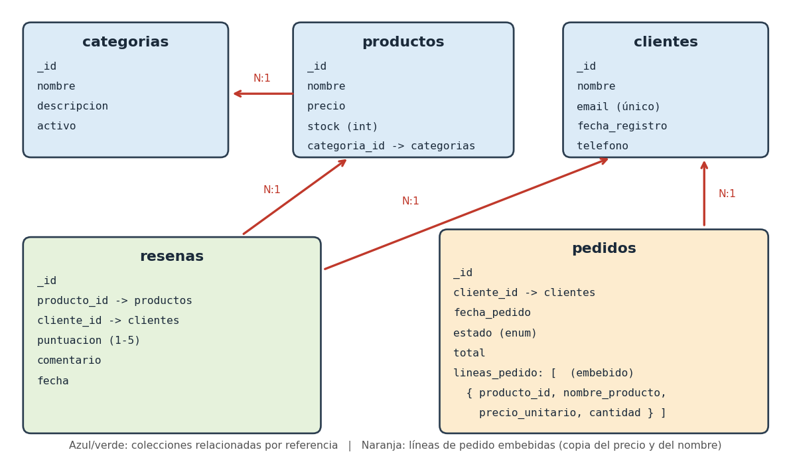

*Figura 1. Modelo físico: cinco colecciones, referencias por ObjectId y líneas de pedido embebidas.*

## 3.2 Colecciones y su propósito

| Colección | Propósito |
|---|---|
| categorias | Departamentos del catálogo (Electrónica, Hogar y Cocina, Deportes). |
| clientes | Cuentas de compradores. El correo es único. |
| productos | Catálogo: nombre, precio, stock y referencia a su categoría. |
| resenas | Valoraciones de 1 a 5 estrellas de un cliente sobre un producto. |
| pedidos | Compras realizadas. Cada pedido contiene sus líneas con copia del nombre y del precio en el momento de la compra. |

## 3.3 Documentos de ejemplo

Son los documentos reales que inserta el script 02.

```javascript
// categorias
{ _id: ObjectId("650000000000000000000001"), nombre: "Electrónica", descripcion: "Dispositivos y gadgets", activo: true }

// clientes
{ _id: ObjectId("650000000000000000000011"), nombre: "Iván Vizcaíno", email: "ivan.vizcaino@example.com",
  fecha_registro: ISODate("2024-01-15T10:00:00Z"), telefono: "+34600111222" }

// productos
{ _id: ObjectId("650000000000000000000021"), nombre: "Portátil Pro 15", precio: 1299.99, stock: 15,
  categoria_id: ObjectId("650000000000000000000001") }

// resenas
{ producto_id: ObjectId("650000000000000000000021"), cliente_id: ObjectId("650000000000000000000011"),
  puntuacion: 5, comentario: "Rendimiento excelente para desarrollo y multitarea.", fecha: ISODate("2024-03-10T14:00:00Z") }

// pedidos (líneas embebidas)
{ cliente_id: ObjectId("650000000000000000000011"), fecha_pedido: ISODate("2024-03-10T09:00:00Z"), estado: "entregado",
  lineas_pedido: [
    { producto_id: ObjectId("650000000000000000000021"), nombre_producto: "Portátil Pro 15", precio_unitario: 1299.99, cantidad: 1 },
    { producto_id: ObjectId("650000000000000000000023"), nombre_producto: "Cafetera Express Automática", precio_unitario: 189.00, cantidad: 1 } ],
  total: 1488.99 }
```

## 3.4 Incrustación frente a referencia

| Decisión | Elección | Justificación |
|---|---|---|
| Líneas de un pedido | Incrustadas en `pedidos` | Se leen siempre junto con el pedido y su número es bajo y acotado. El pedido se escribe en una sola operación. Además guardan `nombre_producto` y `precio_unitario` como copia (patrón snapshot): si el precio cambia mañana, el pedido histórico no cambia. |
| Reseñas de un producto | Referencia (`producto_id`) en `resenas` | Un producto puede acumular miles de reseñas, que crecen sin límite. Incrustarlas haría crecer el documento del producto hacia los 16 MB, se reescribiría entero con cada reseña nueva y habría que traerlas siempre aunque solo se quiera la ficha. |
| Categoría de un producto | Referencia (`categoria_id`) | La categoría es un dato compartido por muchos productos. Si cambia su nombre, se cambia en un único documento. El coste es un `$lookup` cuando se necesita el nombre. |
| Cliente en pedidos y reseñas | Referencia (`cliente_id`) | El cliente tiene vida propia y sus datos personales se pueden modificar o anonimizar sin tocar pedidos ni reseñas. |

## 3.5 Identificadores, fechas, estados y campos opcionales

- **Identificadores:** `ObjectId` generado por MongoDB. En el dataset se fijan valores legibles (`6500…0021`) para que las referencias sean reproducibles entre ejecuciones.
- **Fechas:** siempre tipo `Date` (UTC), no texto, para poder filtrar y ordenar por fecha.
- **Estados:** `pedidos.estado` solo admite `pendiente`, `enviado`, `entregado` o `cancelado` (enumeración en la validación).
- **Campos opcionales:** `descripcion`, `telefono` y `comentario` no son obligatorios. Los productos dados de baja llevan `activo: false` y `fecha_baja`. El esquema no impone `additionalProperties: false`, de modo que se pueden añadir campos nuevos. Las consultas de catálogo usan `activo: { $ne: false }` para incluir también los productos que no tienen el campo.

## 3.6 Límites del modelo

| Aspecto | Situación en este modelo |
|---|---|
| Tamaño máximo de documento (16 MB) | Un pedido con unas decenas de líneas ocupa pocos KB. El esquema de `lineas_pedido` exige al menos 1 línea pero no fija máximo, convendría añadir `maxItems`. |
| Crecimiento de arrays | El único array es `lineas_pedido`, acotado por naturaleza. Las reseñas están fuera de `productos` para evitar un array sin límite. |
| Duplicación | `nombre_producto` y `precio_unitario` se copian a propósito en el pedido. Es consistente con el negocio, pero si se corrige un nombre mal escrito no se propaga a pedidos antiguos. |
| Consistencia | Hacer un pedido implica escribir en `pedidos` y descontar stock en `productos`: son dos documentos de dos colecciones. Para que sean todo o nada se necesita una transacción multidocumento. El descuento condicional (`stock >= cantidad`) evita que el stock quede negativo. |
| Operaciones incómodas | Cruzar datos entre colecciones exige `$lookup` (más costoso que un `JOIN` indexado). No hay restricción de clave foránea: nada impide borrar un producto referenciado, por eso se usa baja lógica. Tampoco se impide que un cliente reseñe el mismo producto dos veces. |

# 4. Validación e índices

## 4.1 Validación con $jsonSchema

El script 01 crea las cinco colecciones con `validationLevel: "strict"` y `validationAction: "error"`, de modo que un documento inválido se rechaza.

| Colección | Obligatorios | Tipos y rangos | Enumeración / formato |
|---|---|---|---|
| categorias | nombre, activo | nombre string, activo bool | — |
| clientes | nombre, email, fecha_registro | fecha_registro date | email con patrón `^.+@.+\..+$` |
| productos | nombre, precio, stock, categoria_id | precio number ≥ 0; stock int ≥ 0; categoria_id objectId | — |
| resenas | producto_id, cliente_id, puntuacion, fecha | puntuacion int entre 1 y 5 | — |
| pedidos | cliente_id, fecha_pedido, estado, lineas_pedido, total | lineas_pedido array con mínimo 1; cantidad int ≥ 1; precio_unitario ≥ 0; total ≥ 0 | estado: pendiente, enviado, entregado, cancelado |

**Prueba de rechazo.** Se intenta insertar un producto con precio negativo (`-25`). MongoDB responde `Document failed validation` (evidencia E02).

## 4.2 Índices

| Índice | Consulta que acelera | Orden de campos | Coste |
|---|---|---|---|
| `idx_productos_precio { precio: 1 }` | P1: filtro y orden por precio | Un solo campo. Sirve tanto para rango como para ordenar | Una entrada por producto, se actualiza al cambiar el precio |
| `idx_clientes_email_unique { email: 1 }`, único | Login y búsqueda por correo, impide correos repetidos | Un solo campo | Cada alta de cliente comprueba unicidad (coste pequeño) |
| `idx_resenas_prod_punt { producto_id: 1, puntuacion: -1 }` | P3: reseñas de un producto ya ordenadas por puntuación | Primero la igualdad (`producto_id`), después el campo de orden (`puntuacion`) | Es el que más crece, porque las reseñas son numerosas, cada reseña nueva escribe en el índice |
| `idx_pedidos_cliente_fecha { cliente_id: 1, fecha_pedido: -1 }` | P4: pedidos de un cliente, del más reciente al más antiguo | Igualdad (`cliente_id`) y después orden (`fecha_pedido`, descendente) | Una entrada por pedido, coste en cada alta de pedido |

Cada índice mejora las lecturas a cambio de ocupar espacio y de que cada inserción, borrado o cambio del campo indexado también actualice el índice. Por eso no se indexan campos que no aparecen en ninguna consulta. Las agregaciones P5 y P6 son informes que recorren toda la colección, así que no se crean índices para ellas.

## 4.3 Reproducir explain antes y después

```javascript
// ANTES (sin el índice si ya existe: db.productos.dropIndex("idx_productos_precio"))
db.productos.find({ precio: { $gte: 100 } }).explain("executionStats").executionStats;

// Se crea el índice (script 03)
db.productos.createIndex({ precio: 1 }, { name: "idx_productos_precio" });

// DESPUÉS
db.productos.find({ precio: { $gte: 100 } }).explain("executionStats").executionStats;
```

## 4.4 Resultado de explain

| Métrica | Antes del índice | Después del índice |
|---|---|---|
| Etapa | COLLSCAN | FETCH con IXSCAN como entrada (`idx_productos_precio`) |
| Claves examinadas | 0 | 2 |
| Documentos examinados | 4 (toda la colección) | 2 |
| Documentos devueltos | 2 | 2 |
| Tiempo de ejecución | 0 ms | 1 ms |

Sin índice, MongoDB recorre los 4 productos para devolver 2. Con índice, localiza directamente las 2 claves que cumplen `precio >= 100` y solo lee esos 2 documentos. Con 4 documentos la diferencia de tiempo no es significativa (el 1 ms es ruido de medición), lo que importa es documentos examinados frente a devueltos: el COLLSCAN crece con el tamaño de la colección, mientras que el IXSCAN crece solo con el número de resultados. Capturas: E04 y E06.

# 5. Consultas y agregaciones

Todas están en `04-consultas.js`.

| Bloque | Qué hace | Pregunta | Evidencia |
|---|---|---|---|
| 1 | `$lookup` + `$unwind` + `$project`: producto con su categoría | P2 | E09 |
| 2 | `$unwind` + `$group` + `$project` + `$sort`: unidades e ingresos por producto | P5 | E10 |
| 3 | `$group` + `$lookup` + `$unwind` + `$project`: puntuación media por producto | P6 | E11 |
| 4 | `find` con filtro y orden: productos de 100 € o más | P1 | E08 |
| 5 | Paginación estable por cursor | P1 | E08 |
| 6 | Reseñas de un producto ordenadas por puntuación | P3 | E08 |
| 7 | Pedidos de un cliente ordenados por fecha | P4 | E08 |
| 8 | CRUD: alta, actualización parcial, descuento de stock y baja lógica | — | E07 |

## 5.1 CRUD: inserción, actualización parcial y baja lógica

- **Inserción** de un producto nuevo pasa por la validación del esquema.
- **Actualización parcial** con `$set` (precio) y `$inc` (stock): solo cambian esos campos.
- **Descuento de stock atómico:** `updateOne` con filtro `stock: { $gte: 3 }` y `$inc: -3`. Si no hay unidades suficientes no modifica nada (`modifiedCount: 0`), lo que evita vender stock que no existe.
- **Baja lógica:** `$set: { activo: false, fecha_baja: new Date() }`. No se borra el documento porque pedidos y reseñas lo referencian.

## 5.2 Filtros combinados, ordenación y paginación estable

La paginación usa `limit` y un orden total: `{ precio: 1, _id: 1 }`. El `_id` desempata productos con el mismo precio, así que el orden nunca cambia entre páginas. En lugar de `skip`, la página 2 se pide **por cursor**: “los que van después del último que vi”, con `$or: [ { precio: { $gt: último.precio } }, { precio: último.precio, _id: { $gt: último._id } } ]`. Con `skip`, MongoDB tiene que recorrer y descartar todas las filas anteriores, y la página 1000 cuesta mucho más que la 1. Con cursor, el coste es el mismo en cualquier página.

## 5.3 Consulta con referencia: $lookup

El bloque 1 une cada producto con su categoría (`localField: categoria_id`, `foreignField: _id`). El resultado esperado, y el que muestran las capturas, es: Portátil Pro 15 y Ratón Inalámbrico Ergonómico en Electrónica, Cafetera Express Automática en Hogar y Cocina, Esterilla Yoga Antideslizante en Deportes. `$unwind` convierte el array de una categoría en un objeto, como cada producto tiene exactamente una, no se pierde ningún producto.

## 5.4 Agregación compleja: ventas por producto

Pipeline de cuatro etapas sobre `pedidos` (las operaciones `$unwind` y `$group` cumplen el requisito de usar al menos dos de las indicadas):

- `$unwind: "$lineas_pedido"` genera un documento por línea de pedido.
- `$group` por `nombre_producto`, sumando `cantidad` y `precio_unitario × cantidad`.
- `$project` renombra el campo y redondea el importe a 2 decimales con `$round`.
- `$sort` por `total_facturado` descendente.

**Resultado esperado con el dataset:** Portátil Pro 15 (1 unidad, 1299,99 €), Cafetera Express Automática (1 unidad, 189 €), Ratón Inalámbrico Ergonómico (2 unidades, 79 €) y Esterilla Yoga Antideslizante (1 unidad, 24,95 €). La suma, 1592,94 €, coincide con la suma de los totales de los 3 pedidos (1488,99 + 79,00 + 24,95).

**Cómo cambia el coste al crecer los datos.** `$unwind` multiplica los documentos por el número de líneas de cada pedido y `$group` mantiene un acumulador por producto, así que el coste crece linealmente con el número de líneas de pedido y la memoria con el número de productos distintos. Esta agregación lee todos los pedidos, por lo que con millones de pedidos habría que: añadir un `$match` inicial por fechas o estado, apoyado en un índice, para no leer el histórico completo, guardar el resultado precalculado en una colección con `$merge` y actualizarlo periódicamente o enviar el histórico antiguo a un sistema analítico (apartado 6.5). Cada etapa tiene un límite de 100 MB de RAM salvo que se use `allowDiskUse`.

## 5.5 Otra agregación: puntuación media por producto

El bloque 3 agrupa `resenas` por `producto_id` (media con `$avg` y recuento) y después hace `$lookup` con `productos` para mostrar el nombre. Resultado esperado: Portátil Pro 15 con media 4,5 y 2 reseñas, Ratón con 5 y 1, Cafetera con 4 y 1. La Esterilla no aparece porque no tiene reseñas. Agrupa antes de hacer el `$lookup` para hacer la unión una vez por producto y no una vez por reseña.

# 6. Copias de seguridad, seguridad y límites

## 6.1 Copia y restauración

El procedimiento completo está en `scripts/05-backup.md`. Resumen:

```bash
# Copia comprimida de ecommerce_db
mongodump --uri="mongodb+srv://<cluster>.mongodb.net/ecommerce_db" --username <usuario> --gzip --out=./backup

# Restauración en otra base (para verificar sin tocar la original)
mongorestore --uri="mongodb+srv://<cluster>.mongodb.net" --username <usuario> --gzip --dir=./backup \
  --nsInclude="ecommerce_db.*" --nsFrom="ecommerce_db.*" --nsTo="ecommerce_db_restaurada.*"
```

La verificación compara el número de documentos de cada colección entre `ecommerce_db` y `ecommerce_db_restaurada`, y comprueba que se han restaurado los índices y el validador. Los clústeres gratuitos de Atlas no incluyen copias gestionadas (*Cloud Backup*), en un clúster de pago, la alternativa equivalente son las instantáneas de Atlas.

**Qué he verificado.** He ejecutado `mongodump` contra Atlas y se han volcado las cinco colecciones (18 documentos, con 5 productos porque ya existía la lámpara del CRUD). He restaurado la copia con `mongorestore` en una base distinta, `ecommerce_db_restaurada`, con 18 documentos restaurados y 0 fallos. Después he comprobado que los recuentos coinciden con la base original en las cinco colecciones, que se han restaurado los índices (por ejemplo `idx_productos_precio`) y que el validador `$jsonSchema` de `productos` se conserva. No he probado la restauración con `--drop` sobre la misma base. Evidencias E12 y E13.

## 6.2 Usuarios, roles y permisos mínimos

| Usuario | Rol | Alcance | Motivo |
|---|---|---|---|
| `tienda_app` (aplicación web) | `readWrite` | solo `ecommerce_db` | Necesita leer y escribir datos de la tienda. No puede gestionar usuarios ni ver otras bases. |
| `analitica` | `read` | solo `ecommerce_db` | Genera informes. No puede modificar datos. |
| `admin_db` | `dbAdmin` y `userAdmin` sobre `ecommerce_db` (o `atlasAdmin` solo en Atlas) | administración | Crea índices, copias y usuarios. Se protege con 2FA y lista de IP permitidas. |

## 6.3 Datos a cifrar, anonimizar o excluir en pruebas

- **Cifrado:** TLS en tránsito y cifrado en reposo de los discos de Atlas. Las copias de seguridad deben guardarse cifradas.
- **Anonimizar:** `nombre`, `email` y `telefono` de `clientes`. Ejemplo para generar una colección de pruebas:

  ```javascript
  db.clientes.aggregate([
    { $project: {
        nombre: { $concat: ["Cliente ", { $toString: "$_id" }] },
        email:  { $concat: ["usuario_", { $toString: "$_id" }, "@test.local"] },
        fecha_registro: 1 } },
    { $out: { db: "ecommerce_db_pruebas", coll: "clientes" } }
  ]);
  ```

- **Excluir:** teléfonos, direcciones y cualquier credencial. Los pedidos y reseñas, tras anonimizar los clientes, no contienen datos personales directos.

## 6.4 Cuándo MongoDB no es la mejor opción

- **Contabilidad y facturación fiscal:** requiere transacciones entre varias tablas, integridad referencial estricta y consultas SQL de auditoría. Un motor relacional como PostgreSQL es más adecuado, o se mantiene MongoDB para el catálogo y se complementa con SQL para el libro de facturas.
- **Recomendaciones sociales (“qué compraron los amigos de mis amigos”):** exige recorrer relaciones de varios niveles. Con `$lookup` encadenados es lento y complejo, una base de grafos como Neo4j lo resuelve de forma natural.

## 6.5 Datos históricos

| Dato | Criterio |
|---|---|
| Pedidos | Se mantienen 2 años en MongoDB para devoluciones y atención al cliente. Después se archivan en un almacén analítico en formato columnar (por ejemplo Parquet en un data lake) y se eliminan de la colección. |
| Reseñas | Se conservan mientras el producto esté en el catálogo, las de productos retirados se archivan. |
| Productos dados de baja | Se conservan con `activo: false` mientras existan pedidos que los referencien. |
| Clientes que se dan de baja | Se anonimizan en lugar de borrarse, para conservar la integridad de pedidos y reseñas (RGPD). |
| Copias de seguridad | 7 diarias y 4 semanales, se prueba una restauración cada trimestre. |

# 7. Evidencias

Cada captura muestra el comando y su resultado en `mongosh` o Compass. El host del clúster está tapado.

## E00. Versión del servidor

`db.version()` en mongosh: MongoDB 8.0.34.

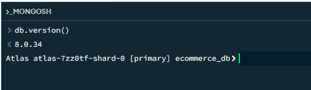

## E01. Colecciones creadas

Resultado del script 01: cinco colecciones en `ecommerce_db`.

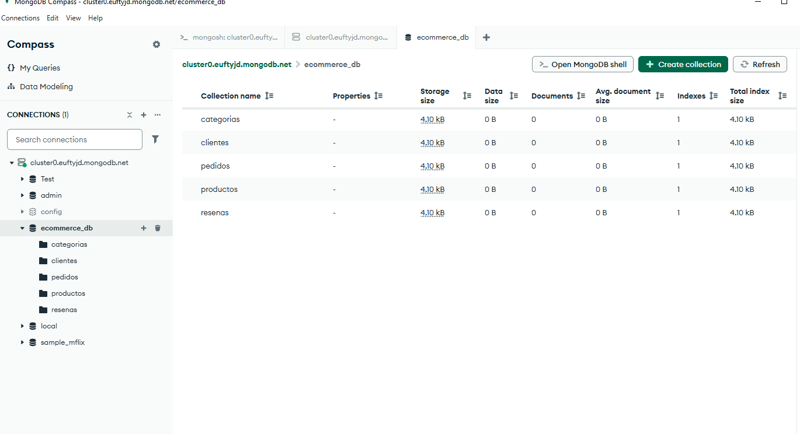

## E02. Validación: rechazo de un documento inválido

Se aplica el validador `$jsonSchema` a `productos` y se intenta insertar un producto con precio negativo.

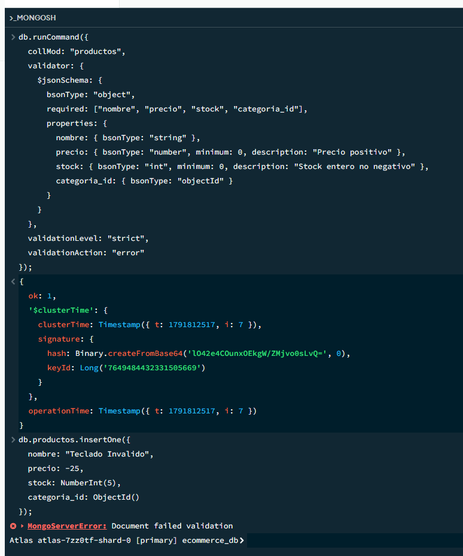

## E03. Inserción del dataset

Final del script 02 y recuentos por colección.

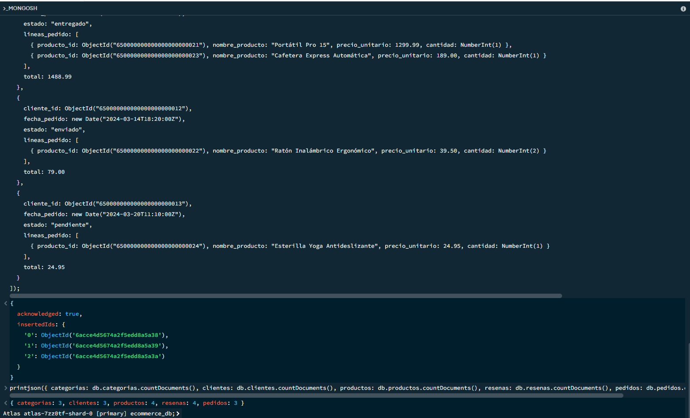

## E04. explain antes del índice

`db.productos.find({ precio: { $gte: 100 } }).explain("executionStats")` sin índice.

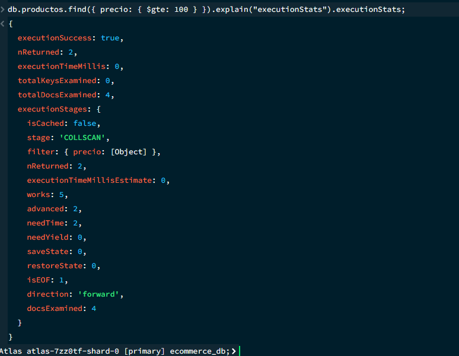

## E05. Creación de índices

Script 03: creación de los cuatro índices y listado de los índices de cada colección.

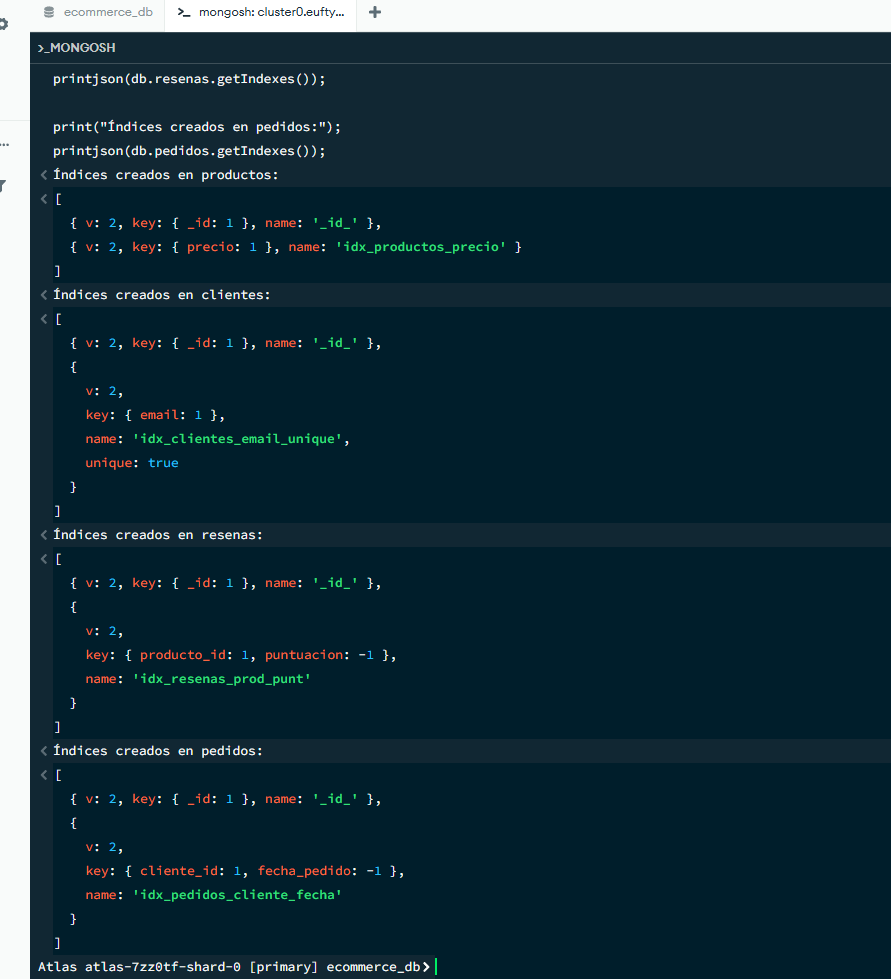

## E06. explain después del índice

Misma consulta con `idx_productos_precio`.

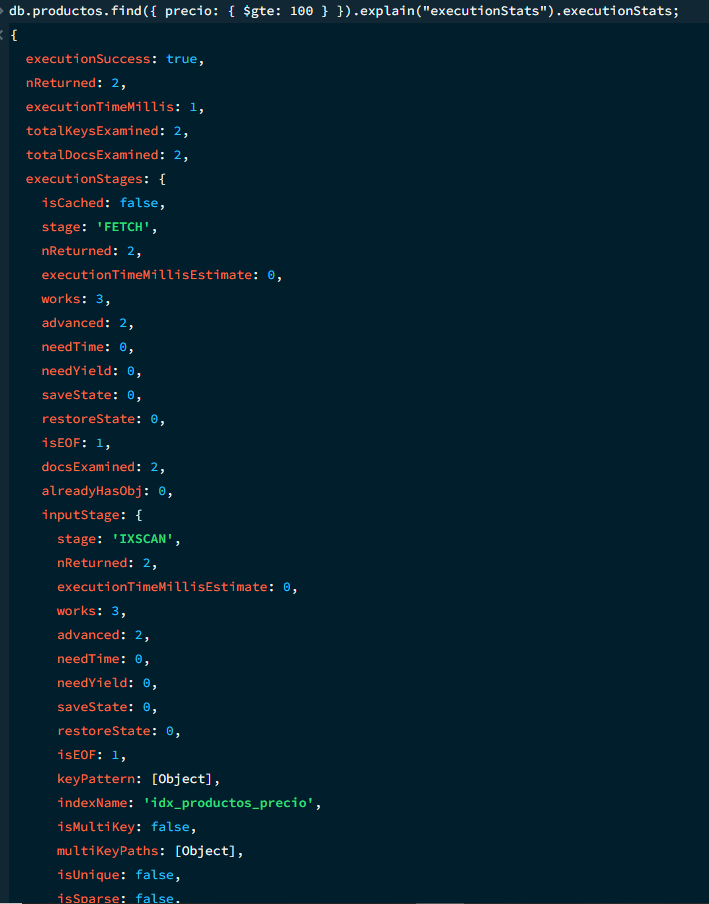

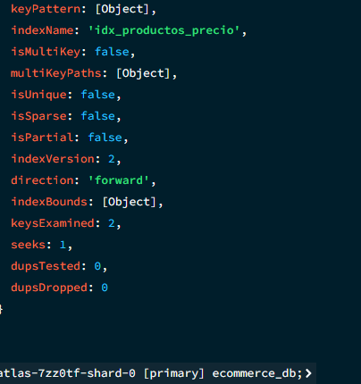

## E07. CRUD

Bloque 8 de `04-consultas.js`: alta, actualización parcial, descuento de stock y baja lógica.

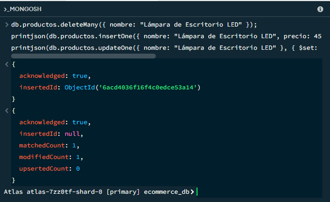

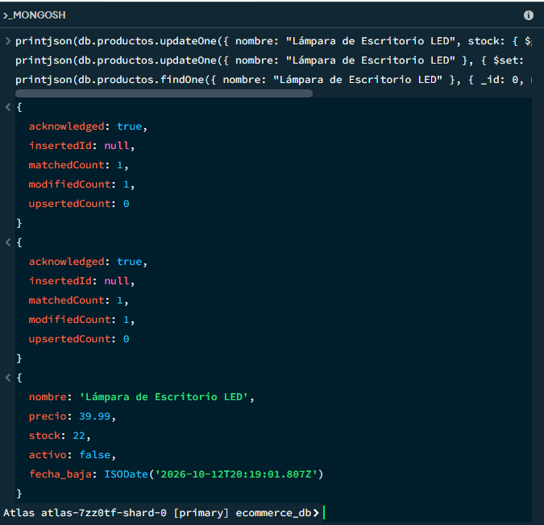

## E08. Consultas, orden y paginación

Bloques 4 a 7 de `04-consultas.js`: P1, paginación por cursor (páginas 1 y 2), P3 y P4.

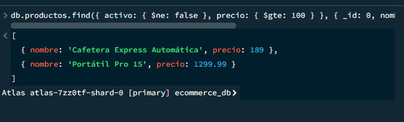

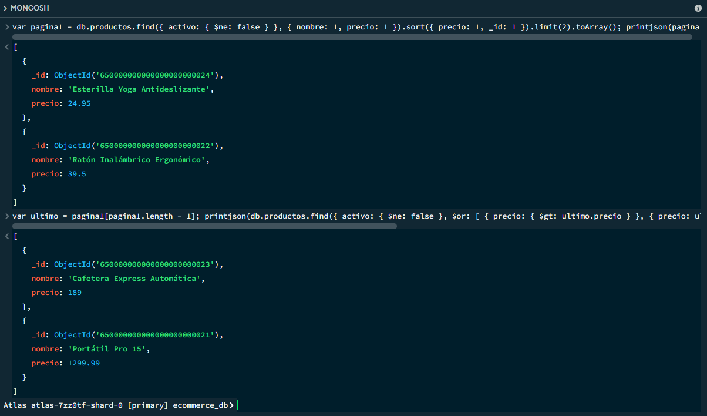

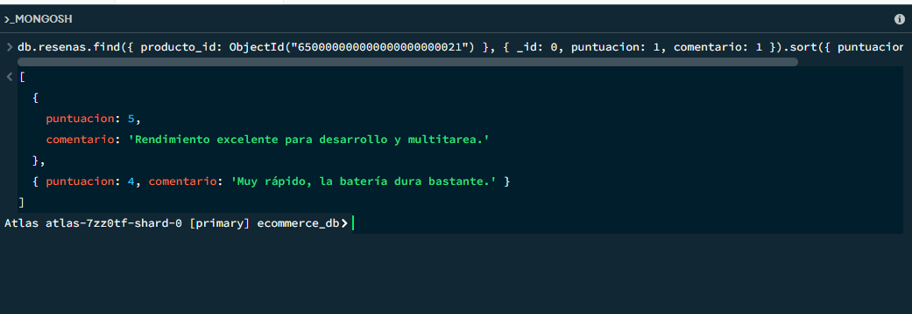

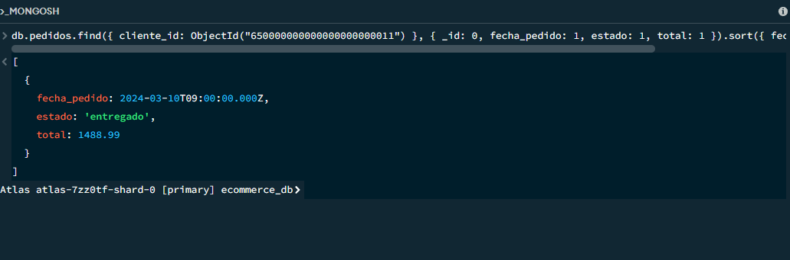

## E09. $lookup: producto con su categoría

Bloque 1 de `04-consultas.js`.

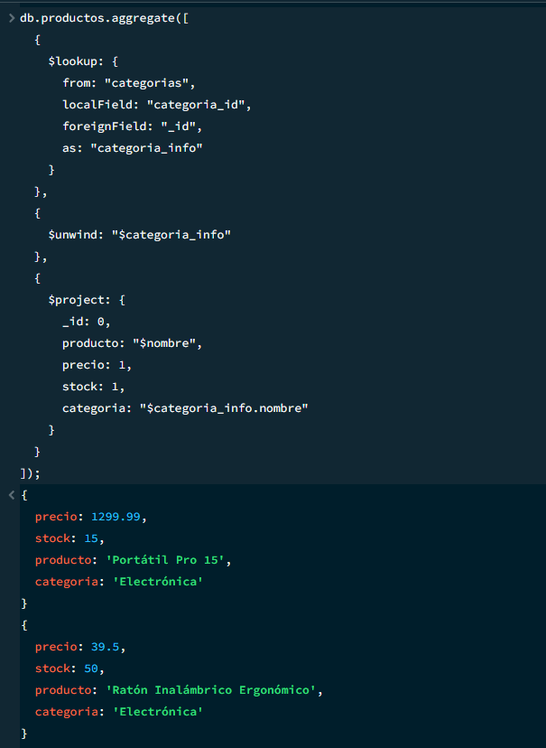

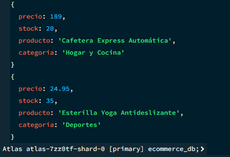

## E10. Agregación de ventas por producto

Bloque 2 de `04-consultas.js`.

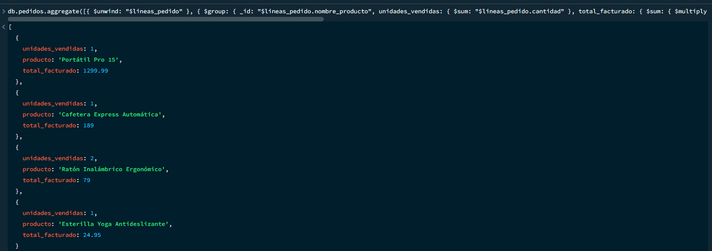

## E11. Agregación de puntuación media

Bloque 3 de `04-consultas.js`.

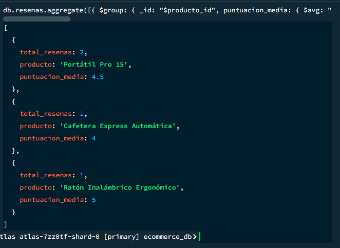

## E12. Copia con mongodump

Apartado 1 de `05-backup.md`.

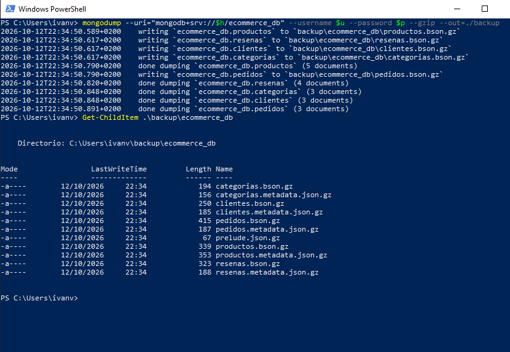

## E13. Restauración y verificación

Apartados 2 y 4 de `05-backup.md`.

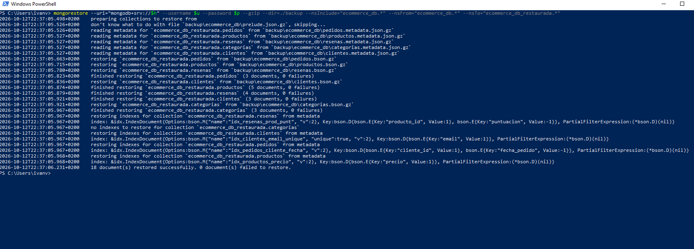

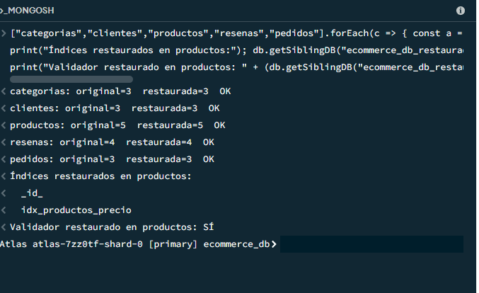
