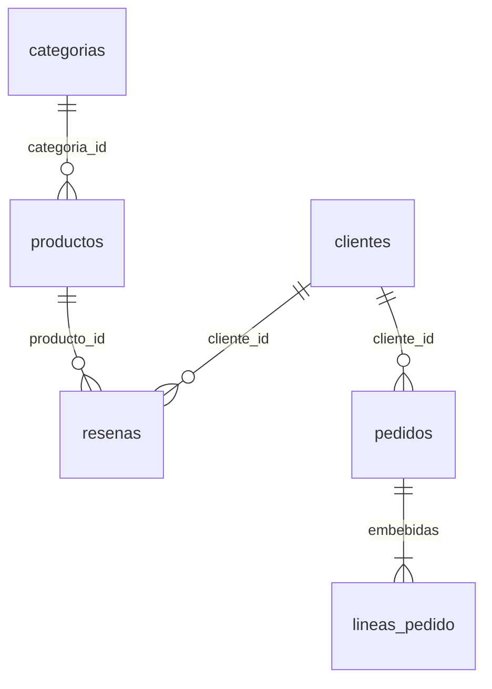

# Modelo de datos

Escenario: catálogo de comercio electrónico en `ecommerce_db` (MongoDB 8.0.34, Atlas).

## Diagrama




## Colecciones

| Colección | Propósito |
|---|---|
| `categorias` | Departamentos del catálogo |
| `clientes` | Cuentas de compradores; el correo es único |
| `productos` | Nombre, precio, stock y referencia a la categoría |
| `resenas` | Valoración de 1 a 5 de un cliente sobre un producto |
| `pedidos` | Compras; cada una incluye sus líneas con copia del nombre y del precio |

## Documentos de ejemplo

```js
// pedidos (líneas embebidas)
{ cliente_id: ObjectId("650000000000000000000011"), fecha_pedido: ISODate("2024-03-10T09:00:00Z"), estado: "entregado",
  lineas_pedido: [
    { producto_id: ObjectId("650000000000000000000021"), nombre_producto: "Portátil Pro 15", precio_unitario: 1299.99, cantidad: 1 },
    { producto_id: ObjectId("650000000000000000000023"), nombre_producto: "Cafetera Express Automática", precio_unitario: 189.00, cantidad: 1 } ],
  total: 1488.99 }

// productos
{ _id: ObjectId("650000000000000000000021"), nombre: "Portátil Pro 15", precio: 1299.99, stock: 15,
  categoria_id: ObjectId("650000000000000000000001") }

// resenas
{ producto_id: ObjectId("650000000000000000000021"), cliente_id: ObjectId("650000000000000000000011"),
  puntuacion: 5, comentario: "Rendimiento excelente para desarrollo y multitarea.", fecha: ISODate("2024-03-10T14:00:00Z") }
```

El resto de documentos (categorías y clientes) están en `scripts/02-datos.js`.

## Incrustación frente a referencia

| Decisión | Elección | Justificación |
|---|---|---|
| Líneas de un pedido | **Incrustadas** | Se leen siempre con el pedido, su número es bajo y acotado, y el pedido se escribe en una sola operación. Guardan `nombre_producto` y `precio_unitario` como copia: si el precio cambia, el pedido histórico no cambia |
| Reseñas de un producto | **Referencia** (`producto_id`) | Pueden ser miles y crecen sin límite: incrustarlas haría crecer el documento del producto hacia los 16 MB y obligaría a reescribirlo con cada reseña |
| Categoría de un producto | **Referencia** (`categoria_id`) | Dato compartido por muchos productos; si cambia, se cambia en un único documento. Coste: un `$lookup` |
| Cliente en pedidos y reseñas | **Referencia** (`cliente_id`) | El cliente tiene vida propia y sus datos personales se pueden modificar o anonimizar sin tocar pedidos ni reseñas |

## Identificadores, fechas, estados y opcionales

- **Identificadores:** `ObjectId`. En el dataset se fijan valores legibles (`6500…0021`) para que las referencias sean reproducibles.
- **Fechas:** tipo `Date` (UTC).
- **Estados:** `pedidos.estado` solo admite `pendiente`, `enviado`, `entregado` o `cancelado`.
- **Opcionales:** `descripcion`, `telefono` y `comentario`. Los productos retirados llevan `activo: false` y `fecha_baja`; las consultas de catálogo usan `activo: { $ne: false }` para incluir los productos que no tienen el campo. El esquema no impone `additionalProperties: false`.

## Validación `$jsonSchema`

Todas las colecciones usan `validationLevel: "strict"` y `validationAction: "error"`.

| Colección | Obligatorios | Tipos y rangos | Enumeración / formato |
|---|---|---|---|
| `categorias` | nombre, activo | activo bool | — |
| `clientes` | nombre, email, fecha_registro | fecha_registro date | email con patrón `^.+@.+\..+$` |
| `productos` | nombre, precio, stock, categoria_id | precio ≥ 0; stock int ≥ 0 | — |
| `resenas` | producto_id, cliente_id, puntuacion, fecha | puntuacion int de 1 a 5 | — |
| `pedidos` | cliente_id, fecha_pedido, estado, lineas_pedido, total | lineas_pedido con mínimo 1; cantidad int ≥ 1 | estado: pendiente, enviado, entregado, cancelado |

## Índices

| Índice | Consulta que acelera | Orden de campos | Coste |
|---|---|---|---|
| `idx_productos_precio` `{ precio: 1 }` | Filtro y orden por precio (P1) | Un solo campo | Se actualiza al cambiar el precio |
| `idx_clientes_email_unique` `{ email: 1 }` único | Búsqueda por correo; impide repetidos | Un solo campo | Comprobación de unicidad en cada alta |
| `idx_resenas_prod_punt` `{ producto_id: 1, puntuacion: -1 }` | Reseñas de un producto ordenadas por puntuación (P3) | Igualdad primero, orden después | El que más crece (muchas reseñas) |
| `idx_pedidos_cliente_fecha` `{ cliente_id: 1, fecha_pedido: -1 }` | Pedidos de un cliente, del más reciente al más antiguo (P4) | Igualdad primero, orden después | Una entrada por pedido |

Las agregaciones de informe (ventas y puntuación media) recorren toda la colección y no tienen índice dedicado.

## Límites del modelo

| Aspecto | Situación |
|---|---|
| Tamaño máximo (16 MB) | Un pedido con decenas de líneas ocupa pocos KB. `lineas_pedido` exige al menos 1 línea pero **no fija máximo**; convendría añadir `maxItems` |
| Crecimiento de arrays | Solo `lineas_pedido`, acotado por naturaleza. Las reseñas están fuera de `productos` |
| Duplicación | `nombre_producto` y `precio_unitario` se copian a propósito; un cambio de nombre no se propaga a pedidos antiguos |
| Consistencia | Hacer un pedido escribe en `pedidos` y descuenta stock en `productos` (dos colecciones): hace falta una transacción multidocumento. El descuento condicional (`stock >= cantidad`) evita stock negativo |
| Operaciones incómodas | Cruzar colecciones exige `$lookup`; no hay clave foránea, por eso se usa baja lógica; no se impide reseñar dos veces el mismo producto |
