# BookSwap · Modelado de grafos con Neo4j

Práctica UT2 · 02 · Escenario: comunidad de intercambio de libros (estilo Goodreads).

## 1. Definir el Problema y los Accesos

### 1.1 Escenario Elegido y Usuarios (Caso página similar a Goodreads)

**Escenario:** BookSwap, plataforma de intercambio de libros donde los lectores apuntan lo que leen, siguen a otros lectores y se apuntan a clubes de lectura donde también intercambian libros que ya han leído por otros.

**Usuarios y sistemas que interactúan:**

* **Lector:** registra lecturas y valoraciones, sigue a otros lectores, ofrece y pide libros prestados.
* **Organizador del club:** crea el club, gestiona miembros y consulta qué lee su club.
* **Moderador:** estudia tendencias (géneros, autores, clubes más activos).
* **Motor de recomendaciones:** genera sugerencias por amigos y por afinidad de gustos.

### 1.2 Siete Preguntas de Negocio que la Base de Datos Debe Responder

1. ¿Qué libros han leído las personas a las que sigo y yo todavía no? (Q2)
2. ¿Qué leen los amigos de mis amigos? (Q2b)
3. ¿Qué lectores tienen gustos afines a los míos y qué me recomiendan? (Q3)
4. ¿Quién tiene disponible, en mi ciudad, un libro de un género concreto? (Q4)
5. ¿Por qué manos ha pasado un ejemplar (cadena de préstamo)? (Q5)
6. ¿Cuántos grados de separación hay entre dos lectores? (Q6)
7. ¿Cuáles son los libros más leídos en un club? (Q7)

### 1.3 Datos con Mayor Frecuencia de Lectura y Escritura

* **Lecturas masivas (tiempo real):** Q2, Q2b, Q3, Q4 (pantalla de inicio y recomendaciones) y Q6/Q7.
* **Escrituras puntuales:** alta de lector, registrar una lectura o valoración, seguir a alguien, registrar un préstamo o su devolución.
* **Proporción esperada:** muchísimas más lecturas que escrituras, lo que encaja bien con un grafo.

### 1.4 Requisitos de Seguridad, Privacidad, Disponibilidad y Crecimiento

* **Seguridad:** conexiones cifradas con TLS (`neo4j+s://`), contraseñas fuera del repositorio y cuentas separadas con mínimo privilegio: una de solo lectura para la app móvil, otra de lectura y escritura para el backend, y el rol `admin` solo para el equipo técnico.
* **Privacidad (RGPD):** el grafo solo guarda un alias y la ciudad, sin nombre real, correo ni dirección. Cada lector decide con `perfilPublico` si sus lecturas son visibles para los demás, y las consultas de recomendación respetan esa marca. Para el derecho de supresión se usa `DETACH DELETE` sobre el lector, sin afectar a libros, autores ni géneros. Los datos de prueba son sintéticos.
* **Disponibilidad:** copias periódicas con `neo4j-admin database dump`, restauración probada y, en producción, clúster con réplicas de lectura para que las recomendaciones sigan funcionando si cae una instancia.
* **Crecimiento:** se prevé pasar de miles a millones de lectores y a decenas de millones de lecturas. Para evitar supernodos (un género como «Novela» o un autor muy popular), las consultas parten siempre de un lector o libro concreto y usan el género solo como filtro. Además, los recorridos de longitud variable llevan límite (`*..8`) y se guardan contadores precalculados cuando haga falta.

## 2. Diseñar el Grafo de Nodos y Relaciones

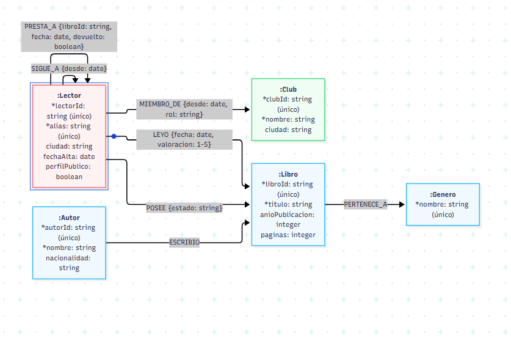

`SIGUE_A` y `PRESTA_A` conectan un `:Lector` con otro `:Lector`, por eso se dibujan como bucles sobre el mismo nodo.

El mismo modelo en Mermaid:

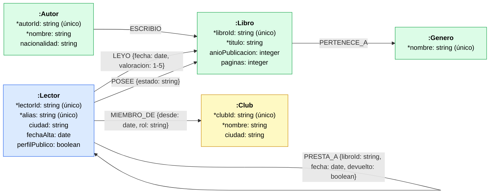

### 2.1 Etiquetas de Nodos y Tipos de Relaciones

**1. Etiquetas de nodos (Labels)** (las propiedades con `*` son obligatorias):

* `:Lector`: cuentas de lectores de la comunidad (`*lectorId`, `*alias`, `ciudad`, `fechaAlta`, `perfilPublico`).
* `:Libro`: obras que se leen, se poseen y se prestan (`*libroId`, `*titulo`, `anioPublicacion`, `paginas`).
* `:Autor`: escritores de los libros (`*autorId`, `*nombre`, `nacionalidad`).
* `:Genero`: estilos literarios (`*nombre`).
* `:Club`: clubes de lectura de la comunidad (`*clubId`, `*nombre`, `ciudad`).

**2. Tipos de relaciones (Relationships):**

* `(:Autor)-[:ESCRIBIO]->(:Libro)`
* `(:Libro)-[:PERTENECE_A]->(:Genero)`
* `(:Lector)-[:LEYO {fecha: "2026-01-08", valoracion: 5}]->(:Libro)`
* `(:Lector)-[:POSEE {estado: "bueno"}]->(:Libro)`
* `(:Lector)-[:SIGUE_A {desde: "2025-10-05"}]->(:Lector)`
* `(:Lector)-[:MIEMBRO_DE {desde: "2025-10-01", rol: "organizador"}]->(:Club)`
* `(:Lector)-[:PRESTA_A {libroId: "B10", fecha: "2026-01-15", devuelto: true}]->(:Lector)`

### 2.2 Nodos y Relaciones de Ejemplo en Cypher

**Nodos de ejemplo**

```cypher
// Un lector (alias ficticio, sin datos personales)
MERGE (l:Lector {lectorId: 'L01'})
SET l.alias = 'ana_lee', l.ciudad = 'Madrid',
    l.fechaAlta = date('2025-09-01'), l.perfilPublico = true;

// Un libro
MERGE (b:Libro {libroId: 'B03'})
SET b.titulo = 'La casa de los espíritus', b.anioPublicacion = 1982, b.paginas = 433;

// Una autora
MERGE (a:Autor {autorId: 'A02'})
SET a.nombre = 'Isabel Allende', a.nacionalidad = 'Chile';

// Un género
MERGE (g:Genero {nombre: 'Realismo mágico'});

// Un club de lectura
MERGE (c:Club {clubId: 'C01'})
SET c.nombre = 'Club Realismo Mágico', c.ciudad = 'Madrid';
```

**Relaciones de ejemplo**

```cypher
// Autor -> Libro
MATCH (a:Autor {autorId: 'A02'}), (b:Libro {libroId: 'B03'})
MERGE (a)-[:ESCRIBIO]->(b);

// Libro -> Género
MATCH (b:Libro {libroId: 'B03'}), (g:Genero {nombre: 'Realismo mágico'})
MERGE (b)-[:PERTENECE_A]->(g);

// Lector -> Libro (con fecha y valoración)
MATCH (l:Lector {lectorId: 'L01'}), (b:Libro {libroId: 'B03'})
MERGE (l)-[r:LEYO]->(b)
  ON CREATE SET r.fecha = date('2026-01-08'), r.valoracion = 5;

// Lector -> Libro (ejemplar que ofrece para intercambio)
MATCH (l:Lector {lectorId: 'L01'}), (b:Libro {libroId: 'B03'})
MERGE (l)-[r:POSEE]->(b)
  ON CREATE SET r.estado = 'muy bueno';

// Lector -> Lector (seguimiento)
MATCH (x:Lector {lectorId: 'L01'}), (y:Lector {lectorId: 'L02'})
MERGE (x)-[r:SIGUE_A]->(y)
  ON CREATE SET r.desde = date('2025-10-05');

// Lector -> Club (con rol)
MATCH (l:Lector {lectorId: 'L01'}), (c:Club {clubId: 'C01'})
MERGE (l)-[r:MIEMBRO_DE]->(c)
  ON CREATE SET r.desde = date('2025-10-01'), r.rol = 'organizador';

// Lector -> Lector (préstamo de un libro)
MATCH (x:Lector {lectorId: 'L01'}), (y:Lector {lectorId: 'L02'})
MERGE (x)-[r:PRESTA_A {libroId: 'B01', fecha: date('2026-01-10')}]->(y)
  ON CREATE SET r.devuelto = true;
```

**Comprobación visual en Neo4j**

```cypher
MATCH p = (:Lector {alias: 'ana_lee'})-[*1..2]-() RETURN p LIMIT 25;
```

### 2.3 Justificación Técnica frente a SQL y Documentos

#### ¿Por qué cada elemento es nodo o propiedad?

La regla aplicada es que algo es **nodo** cuando se consulta por sí mismo, se comparte entre muchos elementos o se recorre para llegar a otros datos, y es **propiedad** cuando solo describe a un elemento y se usa para filtrar o mostrar.

**Nodos:**

* **`:Autor`**: un autor escribe varios libros y un libro puede tener varios autores. Como texto dentro del libro, el nombre se duplicaría y una errata («G. García Márquez» frente a «Gabriel García Márquez») rompería las búsquedas. Como nodo se puede recorrer `(:Autor)-[:ESCRIBIO]->(:Libro)` en ambos sentidos.
* **`:Genero`**: es una categoría compartida por muchos libros. Como nodo, renombrarla es una sola operación y se puede navegar de un libro a todos los de su género. Un libro puede tener más de un género sin cambiar el modelo.
* **`:Club`**: agrupa lectores y tiene vida propia (nombre, ciudad, miembros, roles). Se consulta directamente («libros más leídos en este club»).
* **`:Lector` y `:Libro`**: son las entidades principales a las que se conectan todas las relaciones.

**Propiedades:**

* `titulo`, `anioPublicacion`, `paginas`, `ciudad`, `fechaAlta`, `perfilPublico`, `nacionalidad`: son atributos descriptivos. Se usan para filtrar u ordenar, pero nadie navega «a través» de un año o de un número de páginas.

**Propiedades de relación:**

* `valoracion` y `fecha` en `LEYO` pertenecen a la pareja lector-libro, no a ninguno de los dos por separado.
* `estado` en `POSEE`, `desde` y `rol` en `MIEMBRO_DE`, `desde` en `SIGUE_A` y `libroId`, `fecha` y `devuelto` en `PRESTA_A` son datos de la conexión, no de los nodos.

#### Frente a una base de datos relacional (SQL)

En SQL, este dominio necesitaría tablas `lector`, `libro`, `autor`, `genero`, `club`, `lectura`, `sigue_a`, `prestamo`, `miembro_club`, etc. La pregunta «¿qué leen los amigos de mis amigos y yo no he leído?» exige **4 JOIN y un anti-join** (`NOT EXISTS`), y cada salto más (amigos de amigos de amigos) añade otro `JOIN sigue_a`, con la profundidad fijada en la consulta. En Cypher es un único patrón y subir la profundidad es cambiar `*2` por `*3`.

Además, en SQL cada JOIN busca las filas relacionadas en un índice, y ese coste crece con el tamaño de las tablas. En Neo4j cada nodo guarda punteros directos a sus relaciones (adyacencia libre de índices), así que el coste depende de **cuántos vecinos se recorren**, no del tamaño total de la base de datos.

#### Frente a una base de datos documental (MongoDB)

En un modelo documental, lo natural sería un documento por lector con la lista de libros leídos incrustada. Eso funciona para consultas del tipo «dame el perfil de este lector», pero tiene problemas aquí:

* **Datos duplicados:** el título, el autor y el género se repetirían en cada lectura de cada lector; cambiar un dato exige actualizar muchos documentos.
* **Relaciones entre documentos:** preguntas como «lectores afines», «amigos de amigos» o «cadena de préstamo» obligan a encadenar `$lookup` (equivalentes a JOIN) o a hacer varias consultas desde la aplicación, con rendimiento y complejidad peores.
* **Caminos de longitud variable:** no existe un equivalente directo de `shortestPath` ni de recorridos con profundidad variable.

### 2.4 Estrategia de Identificadores y Propiedades en Relaciones

* **Identificadores unívocos:** códigos legibles de negocio (`lectorId: "L01"`, `libroId: "B03"`, `autorId: "A02"`, `clubId: "C01"`), respaldados por restricciones de unicidad. `Genero` se identifica por su `nombre` y `Lector` también por su `alias`. No se usa el id interno de Neo4j porque no es estable.
* **Tipos de datos:** `string` para identificadores y textos, `integer` para `anioPublicacion`, `paginas` y `valoracion`, `date` para las fechas (`date("2026-01-08")`) y `boolean` para `perfilPublico` y `devuelto`.
* **Propiedades en las relaciones `[:LEYO]`:** la relación guarda la `valoracion` (1 a 5) y la `fecha` de lectura. Esto evita crear una tabla o colección intermedia de valoraciones.
* **Propiedades en las relaciones `[:PRESTA_A]`:** la relación guarda el `libroId`, la `fecha` y si está `devuelto`. Con eso se reconstruye la cadena de préstamo de un ejemplar entre lectores sin nodos intermedios.
* **Otras relaciones con datos propios:** `[:POSEE]` guarda el `estado` del ejemplar, `[:SIGUE_A]` guarda `desde`, y `[:MIEMBRO_DE]` guarda `desde` y `rol`.

### 2.5 Límites del Modelo y Antipatrones Evitados

* **Prevención de supernodos:** un género muy amplio (como «Novela») o un autor muy popular podrían acumular miles de relaciones. Las consultas nunca empiezan en el género o el autor: parten siempre de un lector o un libro concreto, y el género se usa solo como filtro. Si un género creciera demasiado, se dividiría en subgéneros.
* **Recorridos acotados:** los caminos de longitud variable llevan siempre un límite (`*..8`) y las consultas arrancan desde un nodo localizado por índice, nunca con `MATCH (n)` sobre todo el grafo.
* **Antipatrones evitados:** no se crean nodos para datos que nadie recorre (año, páginas, valoración), no se usan relaciones genéricas (`RELACIONADO_CON`) y no se guardan datos personales reales, solo un alias y la ciudad.
* **Operaciones no recomendables:** las agregaciones masivas sobre todo el grafo (por ejemplo, total de páginas leídas por mes en toda la comunidad) y guardar textos largos o archivos (reseñas extensas, portadas) como propiedades. Para eso es mejor una base columnar o relacional, o guardar solo una referencia.
* **Limitación del modelo:** `[:PRESTA_A]` se identifica por `libroId`, así que no distingue entre dos copias del mismo libro. Si la comunidad creciera, se añadiría un nodo `:Ejemplar` entre `:Lector` y `:Libro`.

## 3. Implementar Restricciones, Índices y Carga

Entorno: Neo4j 2026.10.1 Enterprise (Desktop 2.3.1). Scripts completos en [`../scripts/`](../scripts/).

### 3.1 Creación de Restricciones de Unicidad

Cada nodo principal tiene una restricción de unicidad sobre su identificador, para impedir duplicados. Además, al tener edición Enterprise, se fuerzan las propiedades obligatorias con `IS NOT NULL`.

```cypher
CREATE CONSTRAINT lector_id     IF NOT EXISTS FOR (l:Lector) REQUIRE l.lectorId IS UNIQUE;
CREATE CONSTRAINT lector_alias  IF NOT EXISTS FOR (l:Lector) REQUIRE l.alias    IS UNIQUE;
CREATE CONSTRAINT libro_id      IF NOT EXISTS FOR (b:Libro)  REQUIRE b.libroId  IS UNIQUE;
CREATE CONSTRAINT autor_id      IF NOT EXISTS FOR (a:Autor)  REQUIRE a.autorId  IS UNIQUE;
CREATE CONSTRAINT genero_nombre IF NOT EXISTS FOR (g:Genero) REQUIRE g.nombre   IS UNIQUE;
CREATE CONSTRAINT club_id       IF NOT EXISTS FOR (c:Club)   REQUIRE c.clubId   IS UNIQUE;

CREATE CONSTRAINT lector_alias_obligatorio IF NOT EXISTS FOR (l:Lector) REQUIRE l.alias  IS NOT NULL;
CREATE CONSTRAINT libro_titulo_obligatorio IF NOT EXISTS FOR (b:Libro)  REQUIRE b.titulo IS NOT NULL;
CREATE CONSTRAINT autor_nombre_obligatorio IF NOT EXISTS FOR (a:Autor)  REQUIRE a.nombre IS NOT NULL;
```

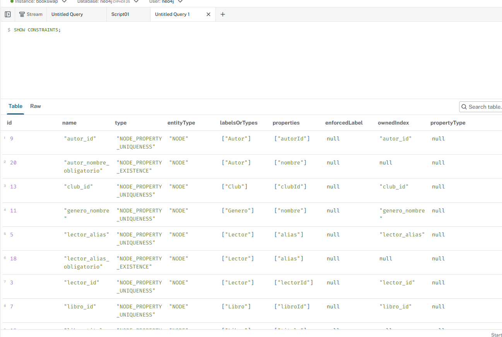

### 3.2 Creación de Índices Secundarios Justificados

* **Índices automáticos:** cada restricción de unicidad crea su propio índice, así que buscar por `lectorId`, `alias`, `libroId`, `autorId`, `clubId` o `Genero.nombre` es inmediato.
* **Índices adicionales:**

```cypher
CREATE INDEX libro_titulo  IF NOT EXISTS FOR (b:Libro)  ON (b.titulo);
CREATE INDEX autor_nombre  IF NOT EXISTS FOR (a:Autor)  ON (a.nombre);
CREATE INDEX club_nombre   IF NOT EXISTS FOR (c:Club)   ON (c.nombre);
CREATE INDEX lector_ciudad IF NOT EXISTS FOR (l:Lector) ON (l.ciudad);
```

* **Justificación:** `titulo` y `nombre` (autor y club) son los puntos de entrada de las búsquedas de los usuarios, y `ciudad` es el filtro de la consulta de disponibilidad cercana. Sin índice, Neo4j recorrería todos los nodos de esa etiqueta.

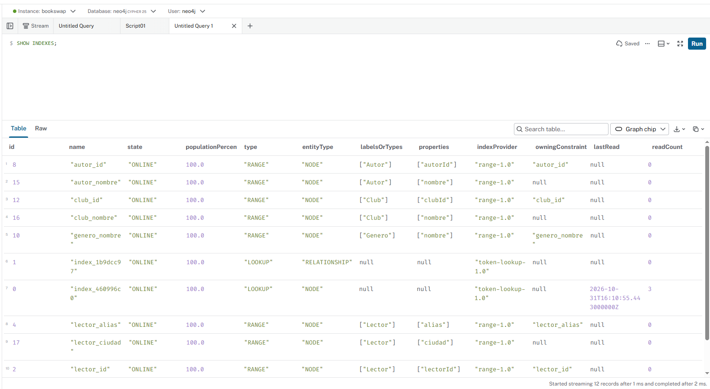

### 3.3 Script de Carga de Datos Completo e Idempotente (MERGE)

* **Idempotencia:** el script usa `MERGE` sobre el identificador de cada nodo y sobre cada relación, con `SET` para actualizar propiedades y `ON CREATE SET` en las relaciones. Se puede ejecutar varias veces sin duplicar nada.
* **Dataset sintético:** 8 lectores, 11 libros, 6 autores, 4 géneros y 3 clubes (32 nodos), con 88 relaciones.
* **Comprobación:** tras ejecutarlo dos veces seguidas, los conteos son idénticos.

El script completo está en [`02-carga-datos.cypher`](../scripts/02-carga-datos.cypher).

Nodos cargados:

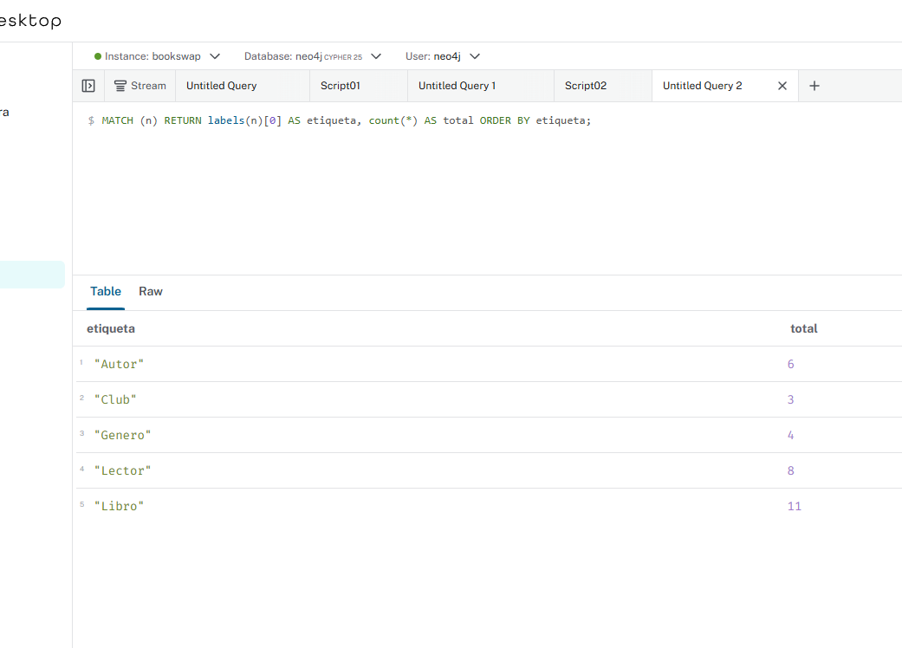

Relaciones cargadas:

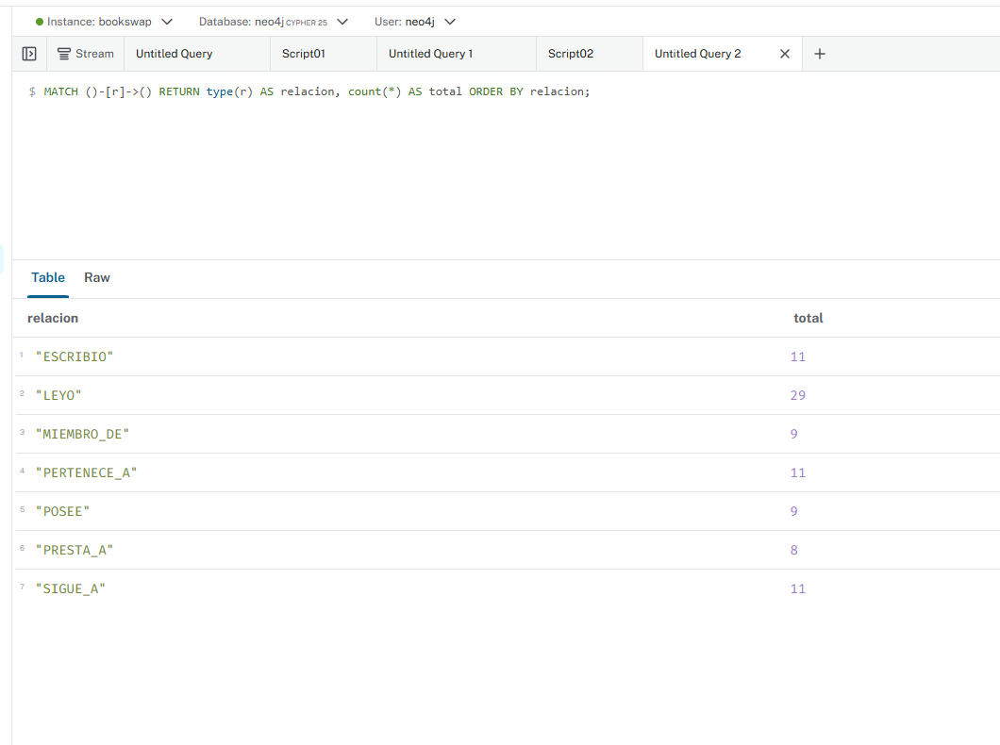

Conteo tras ejecutar el script por segunda vez (idempotencia):

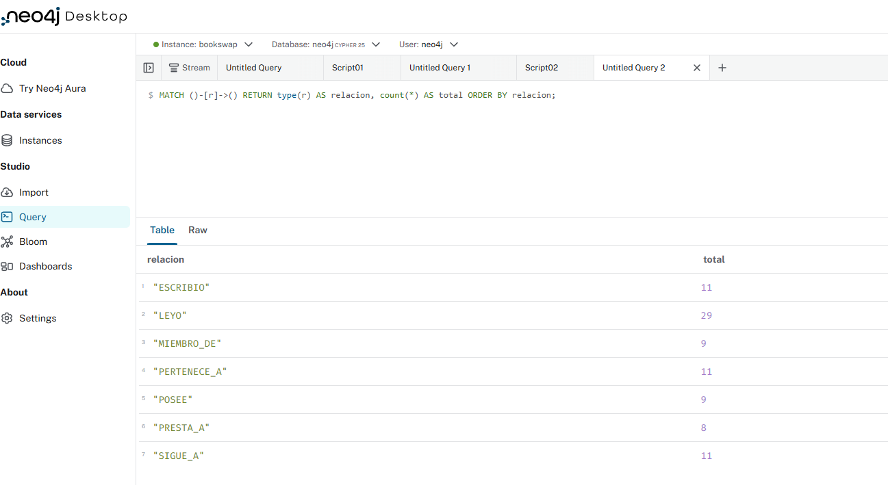

### 3.4 Evidencia de Rendimiento con PROFILE

* **Búsqueda con índice:** `MATCH (b:Libro {titulo: 'Fundación'})<-[:ESCRIBIO]-(a:Autor)` usa **`NodeIndexSeek`** sobre `libro_titulo`: localiza el nodo de inicio directamente, lee 1 fila y hace 7 accesos a la base de datos.
* **Búsqueda por una propiedad sin índice:** `MATCH (b:Libro) WHERE b.paginas = 471` no puede saltar al valor: recorre todas las entradas (`NodeIndexScan`) y aplica un `Filter`, con 11 filas leídas y 23 accesos. En una base con millones de libros, esa diferencia sería enorme.
* **Conclusión:** los índices permiten encontrar el nodo de inicio al instante sin escanear el grafo, y es desde ahí donde Neo4j sigue las relaciones.

```cypher
PROFILE
MATCH (b:Libro {titulo: 'Fundación'})<-[:ESCRIBIO]-(a:Autor)
RETURN a.nombre AS autor, b.titulo AS libro;

PROFILE
MATCH (b:Libro) WHERE b.paginas = 471
RETURN b.titulo;
```

Con índice (`NodeIndexSeek`):

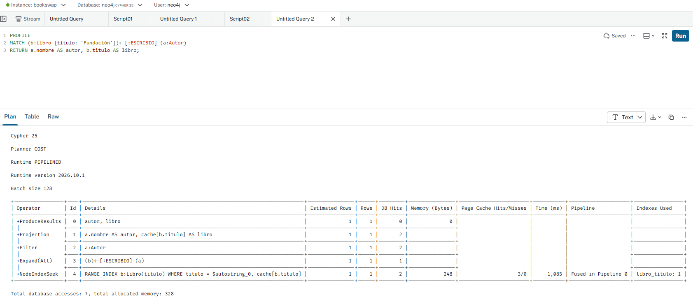

Sin índice de búsqueda (`NodeIndexScan` + `Filter`):

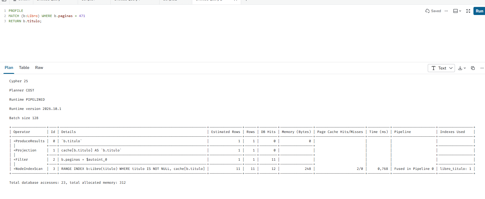

## 4. Resolver Consultas Cypher y Caminos Complejos

Todas las consultas están en [`03-consultas-recorridos.cypher`](../scripts/03-consultas-recorridos.cypher).

### 4.1 Operación Básica: Crear o Actualizar con MERGE y SET

* **Qué hace:** da de alta al lector `L09` y registra que ha leído *Fundación* con una valoración de 4.
* **Seguridad:** `MERGE` sobre `lectorId` evita duplicar el nodo, `ON CREATE SET` fija la fecha solo la primera vez, y `SET` permite actualizar alias, ciudad o valoración en ejecuciones posteriores.
* **Comprobación:** al ejecutarla dos veces seguidas sigue habiendo un solo lector y una sola lectura.

```cypher
MERGE (l:Lector {lectorId: 'L09'})
  ON CREATE SET l.fechaAlta = date('2026-10-19')
SET l.alias = 'irene_libros', l.ciudad = 'Madrid', l.perfilPublico = true
WITH l
MATCH (b:Libro {libroId: 'B06'})
MERGE (l)-[r:LEYO]->(b)
  ON CREATE SET r.fecha = date('2026-10-19')
SET r.valoracion = 4
RETURN l.alias AS lector, b.titulo AS libro, r.valoracion AS valoracion, r.fecha AS fecha;
```

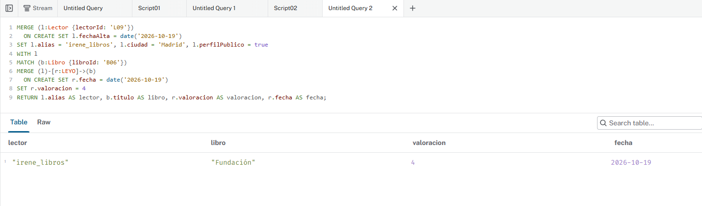

Comprobación de que no hay duplicados:

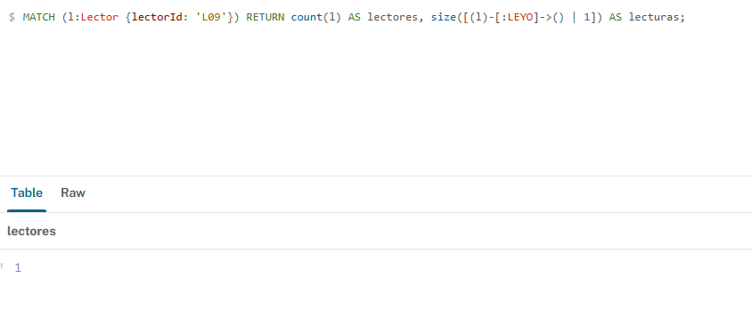

### 4.2 Consulta de 1 Salto: Libros de una Autora con Año, Páginas y Género

* **Qué hace:** parte de la autora (localizada por el índice `autor_nombre`) y recorre sus vecinos inmediatos: sus libros y el género de cada uno.
* **Resultado:** *La casa de los espíritus* (1982, 433 páginas) y *Eva Luna* (1987, 330 páginas), ambos de Realismo mágico, ordenados por año.

```cypher
MATCH (a:Autor {nombre: 'Isabel Allende'})-[:ESCRIBIO]->(b:Libro)-[:PERTENECE_A]->(g:Genero)
RETURN b.titulo AS titulo, b.anioPublicacion AS anio, b.paginas AS paginas, g.nombre AS genero
ORDER BY anio;
```

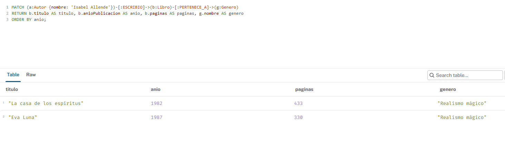

### 4.3 Consultas de Varios Saltos

* **Libros de mis amigos que yo no he leído:** recorre `(:Lector)-[:SIGUE_A]->(:Lector)-[:LEYO]->(:Libro)`, filtra los perfiles públicos y excluye con `NOT (yo)-[:LEYO]->(libro)` lo que ya he leído. Agrupa por libro, cuenta cuántos amigos lo leyeron y calcula la valoración media, ordenando por popularidad entre mis amigos. Resultado: *Eva Luna* encabeza la lista (2 amigos, 3.5).
* **Amigos de mis amigos:** usa `[:SIGUE_A*2]` para llegar a dos saltos y descarta a quien ya sigo y a mí mismo. Resultado: `diego_novel` aporta *Yo, robot* (5.0), *Fundación* (4.0) y *La mano izquierda de la oscuridad* (4.0).
* **Privacidad:** el filtro `perfilPublico = true` respeta la decisión del lector sobre si sus lecturas son visibles.

```cypher
MATCH (yo:Lector {alias: 'ana_lee'})-[:SIGUE_A]->(amigo:Lector)-[r:LEYO]->(libro:Libro)
WHERE amigo.perfilPublico = true
  AND NOT (yo)-[:LEYO]->(libro)
RETURN libro.titulo                     AS recomendado,
       count(DISTINCT amigo)            AS amigosQueLoLeyeron,
       round(avg(r.valoracion), 2)      AS valoracionMedia,
       collect(DISTINCT amigo.alias)    AS amigos
ORDER BY amigosQueLoLeyeron DESC, valoracionMedia DESC, recomendado;
```

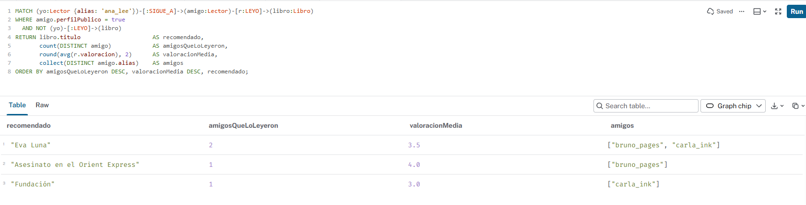

```cypher
MATCH (yo:Lector {alias: 'ana_lee'})-[:SIGUE_A*2]->(fof:Lector)
WHERE fof <> yo AND NOT (yo)-[:SIGUE_A]->(fof)
WITH DISTINCT yo, fof
MATCH (fof)-[r:LEYO]->(b:Libro)
WHERE NOT (yo)-[:LEYO]->(b)
RETURN b.titulo AS recomendado, collect(fof.alias) AS leidoPor, round(avg(r.valoracion), 2) AS media
ORDER BY media DESC, recomendado;
```

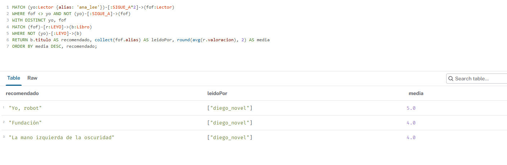

### 4.4 Recomendación por Afinidad

* **Idea:** se buscan lectores con gustos parecidos a los de `ana_lee`, es decir, que hayan puntuado con 4 o más al menos dos libros que ella también puntuó con 4 o más. Después se recomienda lo que esos lectores afines valoraron bien y ella aún no ha leído.
* **Patrón:** `(:Lector)-[:LEYO]->(:Libro)<-[:LEYO]-(:Lector)` (libros en común), y luego un segundo salto desde el lector afín hacia otros libros.
* **Resultado:** `bruno_pages` y `carla_ink` comparten dos libros muy bien valorados con `ana_lee`, y de ellos salen *Asesinato en el Orient Express* y *Eva Luna*. Se descartan *Eva Luna* de `bruno_pages` (la valoró con 3) y *Fundación* de `carla_ink` (la valoró con 3).

```cypher
MATCH (yo:Lector {alias: 'ana_lee'})-[r1:LEYO]->(b:Libro)<-[r2:LEYO]-(afin:Lector)
WHERE afin <> yo AND r1.valoracion >= 4 AND r2.valoracion >= 4
WITH yo, afin, count(b) AS enComun
WHERE enComun >= 2
MATCH (afin)-[r3:LEYO]->(rec:Libro)
WHERE r3.valoracion >= 4 AND NOT (yo)-[:LEYO]->(rec)
RETURN rec.titulo AS recomendado,
       collect(DISTINCT afin.alias) AS loRecomiendan,
       round(avg(r3.valoracion), 2) AS media
ORDER BY size(loRecomiendan) DESC, media DESC, recomendado;
```

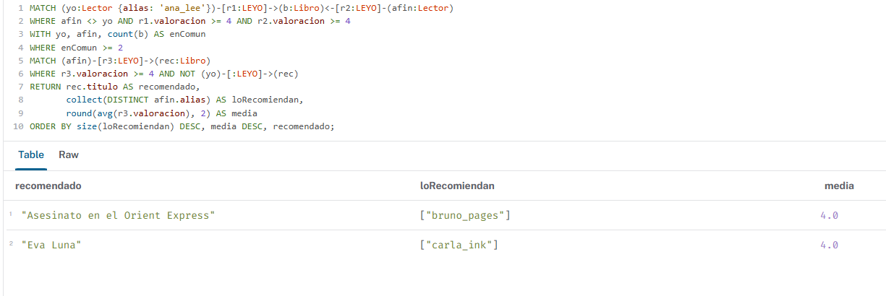

### 4.5 Disponibilidad Cercana y Cadena de Préstamo

* **Disponibilidad cercana:** parte de los lectores de una ciudad (índice `lector_ciudad`), recorre `POSEE` hasta los libros del género pedido y descarta con `NOT EXISTS` los ejemplares que su dueño tiene prestados sin devolver (`devuelto: false`). Resultado: solo *Los desposeídos*, de `elena_sf`, está disponible en Valencia; *Yo, robot* no aparece porque `diego_novel` lo ha prestado.
* **Cadena de préstamo:** sigue `[:PRESTA_A*1..5]` filtrando por el mismo `libroId` y comprueba que las fechas van en orden creciente, para reconstruir por qué manos ha pasado un ejemplar. Resultado: el libro B10 pasó de `fran_misterio` a `gema_cuentos`, luego a `hugo_lector` y por último a `elena_sf` (3 saltos).

```cypher
MATCH (dueno:Lector {ciudad: 'Valencia'})-[p:POSEE]->(b:Libro)-[:PERTENECE_A]->(:Genero {nombre: 'Ciencia ficción'})
WHERE NOT EXISTS {
  MATCH (dueno)-[:PRESTA_A {libroId: b.libroId, devuelto: false}]->()
}
RETURN dueno.alias AS propietario, b.titulo AS libro, p.estado AS estado;
```

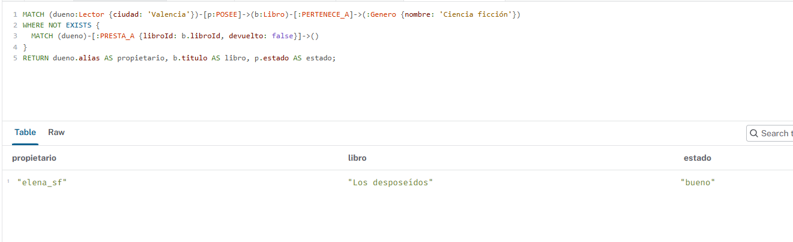

```cypher
MATCH path = (:Lector {alias: 'fran_misterio'})-[rs:PRESTA_A*1..5 {libroId: 'B10'}]->(fin:Lector)
WHERE ALL(i IN range(0, size(rs) - 2) WHERE rs[i].fecha <= rs[i + 1].fecha)
RETURN [n IN nodes(path) | n.alias] AS cadena, length(path) AS saltos
ORDER BY saltos DESC;
```

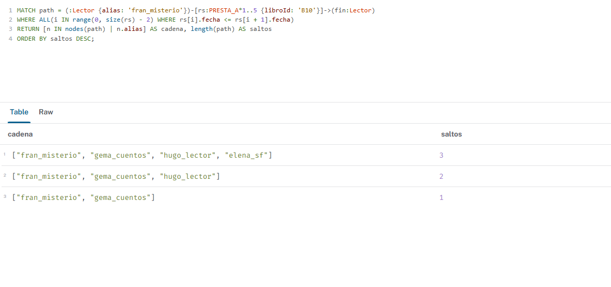

### 4.6 Camino Más Corto y Libros Más Leídos de un Club

* **Camino más corto:** `shortestPath((a)-[:SIGUE_A*..8]-(b))` calcula los grados de separación entre dos lectores, siguiendo `SIGUE_A` en cualquier dirección y con un límite de 8 saltos. Resultado: entre `ana_lee` y `hugo_lector` hay **4 grados** (`ana_lee → bruno_pages → diego_novel → elena_sf → hugo_lector`).
* **Todos los caminos mínimos:** `allShortestPaths` devuelve todas las rutas de esa longitud. Hay dos: una por `bruno_pages` y otra por `carla_ink`. Se usa `DISTINCT` porque, al seguirse mutuamente algunos lectores, el mismo camino aparecería repetido.
* **Libros más leídos de un club:** parte del club (índice `club_nombre`), recorre `MIEMBRO_DE` hasta sus lectores y de ellos a los libros que han leído. Resultado: en el Club Ciencia Ficción, *La mano izquierda de la oscuridad* es el más leído (3 lectores, media 4.33).

```cypher
MATCH (a:Lector {alias: 'ana_lee'}), (b:Lector {alias: 'hugo_lector'})
MATCH p = shortestPath((a)-[:SIGUE_A*..8]-(b))
RETURN [n IN nodes(p) | n.alias] AS camino, length(p) AS grados;
```

```cypher
MATCH (a:Lector {alias: 'ana_lee'}), (b:Lector {alias: 'hugo_lector'})
MATCH p = allShortestPaths((a)-[:SIGUE_A*..8]-(b))
RETURN DISTINCT [n IN nodes(p) | n.alias] AS camino, length(p) AS grados;
```

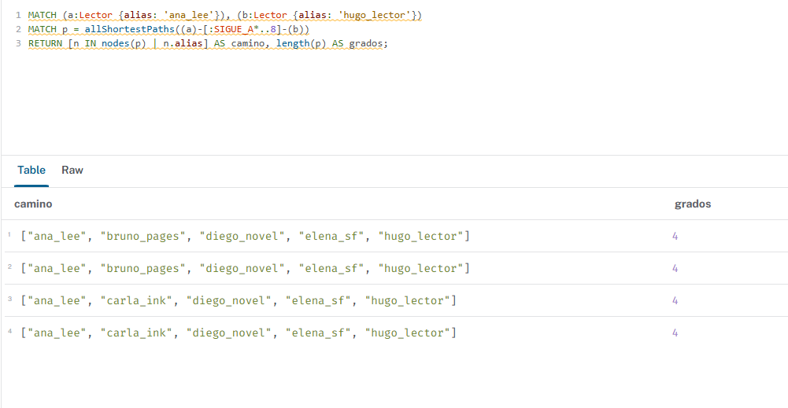

```cypher
MATCH (c:Club {nombre: 'Club Ciencia Ficción'})<-[:MIEMBRO_DE]-(m:Lector)-[r:LEYO]->(b:Libro)
RETURN b.titulo AS libro, count(m) AS lectoresDelClub, round(avg(r.valoracion), 2) AS media
ORDER BY lectoresDelClub DESC, media DESC, libro
LIMIT 5;
```

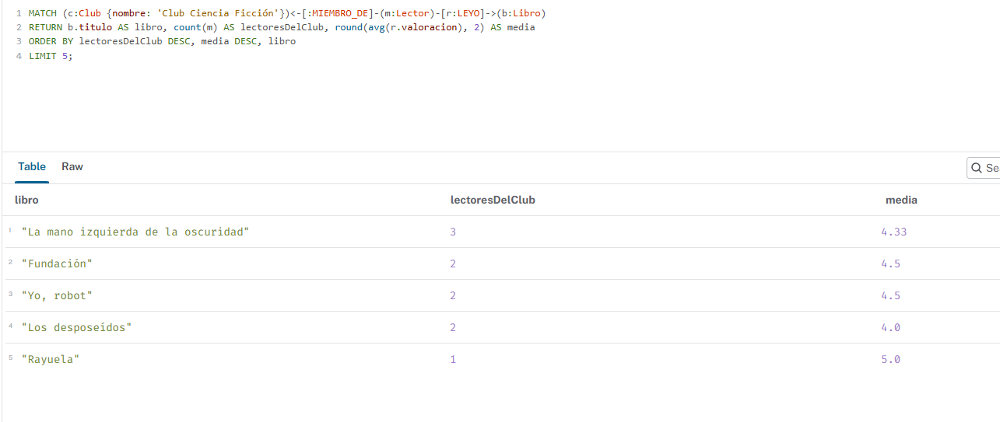

### 4.7 ¿Por Qué Neo4j Resuelve Estos Caminos en Milisegundos?

* **Adyacencia libre de índices:** en Neo4j cada nodo guarda punteros físicos directos a sus relaciones, y cada relación apunta a los nodos que une. Para pasar de un lector a quienes sigue basta con seguir esos punteros, sin buscar en ningún índice.
* **El coste depende de los vecinos, no del tamaño total:** recorrer 4 saltos desde `ana_lee` solo visita los nodos de su entorno, aunque la base de datos tenga millones de lectores.
* **Frente a SQL:** cada `JOIN` consulta un índice o una tabla para encontrar las filas relacionadas, y ese coste crece con el tamaño de las tablas. Con 4 o 5 `JOIN` encadenados, el trabajo y la memoria se multiplican.
* **Evidencia:** el `PROFILE` del apartado 3.4 muestra que la consulta solo localiza el nodo de partida con el índice (`NodeIndexSeek`) y desde ahí se mueve siguiendo relaciones (`Expand`), con 7 accesos a la base de datos en total.

## 5. Comparación Técnica, Seguridad y Copias

### 5.1 Comparativa Técnica: Neo4j frente a SQL

Consulta elegida: **libros que leen los amigos de mis amigos y yo aún no he leído.**

* **En Neo4j (Cypher):** un único patrón, sin `JOIN`.

```cypher
MATCH (yo:Lector {alias:'ana_lee'})-[:SIGUE_A*2]->(fof)-[r:LEYO]->(b:Libro)
WHERE fof <> yo AND NOT (yo)-[:LEYO]->(b)
RETURN b.titulo, avg(r.valoracion);
```

* **En SQL tradicional:** 5 tablas (`lector`, `sigue_a` dos veces, `lectura`, `libro`), es decir, **4 `JOIN` más un anti-join** (`NOT EXISTS`).

```sql
SELECT b.titulo, AVG(le.valoracion)
FROM lector yo
JOIN sigue_a s1 ON s1.seguidor_id = yo.lector_id
JOIN sigue_a s2 ON s2.seguidor_id = s1.seguido_id
JOIN lectura le ON le.lector_id   = s2.seguido_id
JOIN libro b    ON b.libro_id     = le.libro_id
WHERE yo.alias = 'ana_lee'
  AND s2.seguido_id <> yo.lector_id
  AND NOT EXISTS (SELECT 1 FROM lectura l2
                  WHERE l2.lector_id = yo.lector_id AND l2.libro_id = b.libro_id)
GROUP BY b.titulo;
```

* **Complejidad:** en SQL cada salto extra (amigos de amigos de amigos) añade otro `JOIN sigue_a` y la profundidad queda fijada en la consulta. En Cypher solo cambia `*2` por `*3`. Además, cada `JOIN` busca en un índice y su coste crece con el tamaño de las tablas, mientras que en Neo4j depende de los vecinos visitados.

### 5.2 Copias de Seguridad y Restauración

* **Copia (volcado):** con la instancia parada se genera un archivo `.dump` de la base de datos `neo4j`. En Neo4j Desktop se hace desde el menú **[...]** de la instancia, opción *Export databases*. Por línea de comandos sería `neo4j-admin database dump neo4j --to-path=<carpeta>`.
* **Restauración:** se carga el `.dump` en una instancia parada (*Load database from file* en Desktop, o `neo4j-admin database load neo4j --from-path=<carpeta> --overwrite-destination=true`). También se puede crear una instancia nueva a partir del archivo.
* **Neo4j Aura:** se usan las copias (*snapshots*) y la exportación o importación de un `.dump` desde la consola.
* **Copia lógica complementaria:** como el script `02-carga-datos.cypher` es idempotente (`MERGE`), sirve también como copia del dataset: ejecutado sobre una base vacía reproduce el grafo completo.
* **Comprobación tras restaurar:** 33 nodos y 89 relaciones, si se hizo la copia después de la Q0.
* **Evidencia:** el volcado generado desde Neo4j Desktop es `neo4j-2026-10-31T22-14-13.dump` (17 KB), guardado en la carpeta `dumps`.

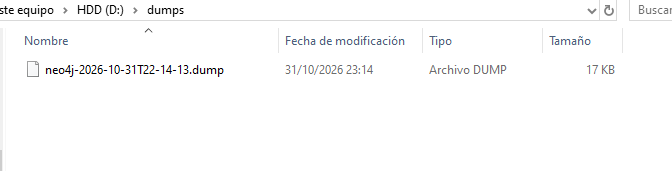

Procedimiento completo en [`04-backup.md`](../scripts/04-backup.md).

### 5.3 Seguridad y Permisos (Roles Mínimos)

* **`rol_lectura` (aplicación móvil):** solo puede acceder a la base de datos y leer nodos y relaciones (`MATCH`). No puede crear, modificar ni borrar.
* **`rol_escritura` (backend de la comunidad):** lectura más escritura de datos (`WRITE`), pero sin permisos para crear usuarios, roles ni cambiar el esquema.
* **`admin` (equipo técnico):** rol integrado, solo para tareas de administración.
* **Principio de mínimo privilegio:** cada cuenta tiene solo lo que necesita, de modo que una app móvil comprometida no puede borrar datos.
* **Medidas complementarias:** conexiones cifradas (`neo4j+s://`), contraseñas en un gestor de secretos y no en el repositorio.

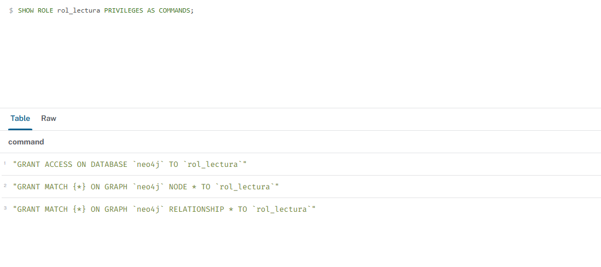

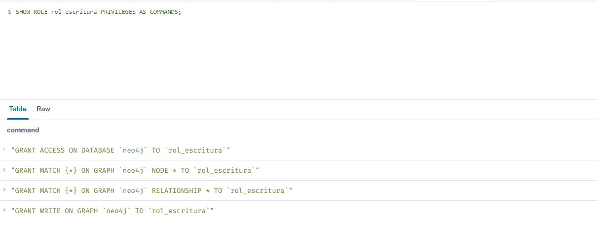

### 5.4 Cuándo NO Usar Neo4j

* **Analítica agregada masiva** (por ejemplo, total de páginas leídas por mes en toda la comunidad): una base columnar (ClickHouse, BigQuery) recorre columnas enteras mucho más rápido, porque no necesita relaciones.
* **Datos transaccionales tabulares o documentales** (facturación, inventario, fichas completas de usuario con adjuntos): una base relacional (PostgreSQL) ofrece integridad referencial estricta y transacciones multi-tabla maduras, y una documental (MongoDB) encaja mejor con documentos autocontenidos.
