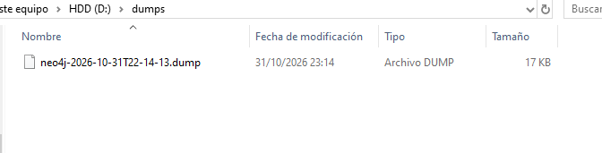
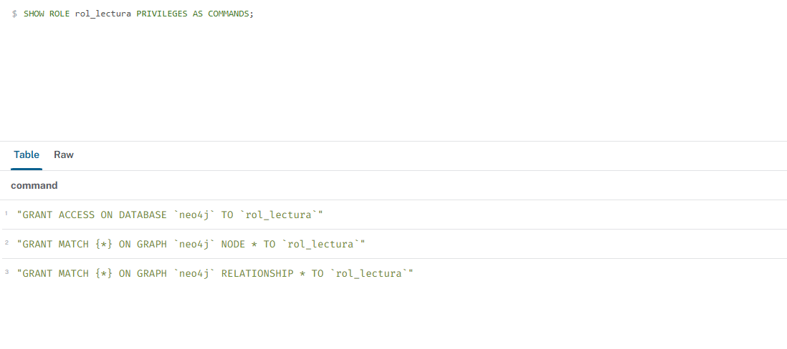
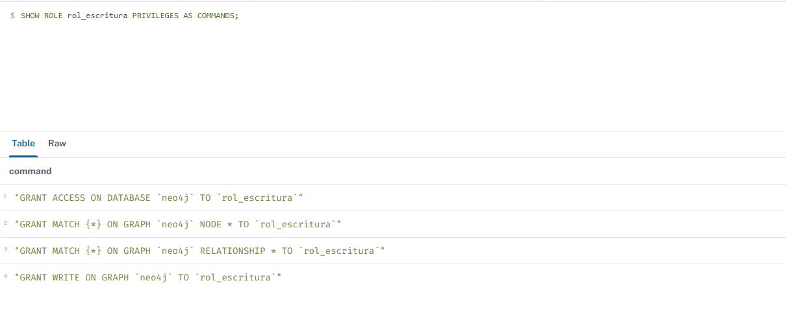

# 04 · Copias de seguridad, restauración y seguridad

> Entorno de la práctica: Neo4j 2026.10.1 Enterprise (Developer) en Neo4j Desktop 2.3.1.
> Sustituye rutas y contraseñas por las de tu entorno. **No se entregan credenciales reales.**

## 1. Copia de seguridad (volcado)

### En Neo4j Desktop (el método usado en la práctica)

1. En **Instances**, detén la instancia `bookswap` (botón *stop*). La exportación exige la instancia parada.
2. Abre el menú **[...]** de la instancia → **Export databases**.
3. Selecciona la base de datos `neo4j` (la base `system` no se exporta) y pulsa **Export .dump**; elige la carpeta de destino.
4. Se genera un archivo `.dump`. En la práctica: `neo4j-2026-10-31T22-14-13.dump` (17 KB), en la carpeta `dumps`.
5. Vuelve a arrancar la instancia.

Evidencia: [`docs/evidencias/05-backup-dump.png`](../docs/evidencias/05-backup-dump.png)



### Por línea de comandos (servidor Neo4j)

```bash
# 1. Detener la base de datos (o la instancia)
neo4j stop

# 2. Volcar la base de datos "neo4j" a una carpeta; genera <carpeta>/neo4j.dump
neo4j-admin database dump neo4j --to-path=/backups/2026-10-31

# 3. Arrancar de nuevo
neo4j start
```

En Enterprise existe además la copia en caliente: `neo4j-admin database backup`.

### Neo4j Aura

Desde la consola: apartado *Snapshots* (copias automáticas y bajo demanda según el plan) y exportación o importación de un `.dump`. Comprueba qué ofrece tu plan.

## 2. Restauración

### En Neo4j Desktop

* **Load database from file** (menú **[...]** de una instancia parada): carga un `.dump`, `.tar` o `.backup` como una base de datos nueva. El nombre se toma del archivo y no puede coincidir con una base existente: la carga no sobrescribe.
* **Create from backup**: crea una instancia nueva a partir del archivo.

### Por línea de comandos

```bash
neo4j stop
neo4j-admin database load neo4j --from-path=/backups/2026-10-31 --overwrite-destination=true
neo4j start
```

Comprobación tras restaurar (33 nodos y 89 relaciones si la copia se hizo después de la Q0; 32 y 88 si fue antes):

```cypher
MATCH (n) RETURN count(n) AS nodos;
MATCH ()-[r]->() RETURN count(r) AS relaciones;
```

## 3. Copia lógica (complementaria)

Como `02-carga-datos.cypher` es idempotente (`MERGE`), el propio script sirve de copia lógica del dataset: ejecutado sobre una base vacía (o sobre la misma) reproduce el grafo sin duplicados.

## 4. Seguridad y permisos (RBAC, mínimo privilegio)

Los roles personalizados requieren edición **Enterprise** o Aura de pago (la edición Developer de Desktop los incluye). En Community solo existe un administrador, por lo que se documentaría como diseño objetivo.

```cypher
// Rol de solo lectura: aplicación móvil
CREATE ROLE rol_lectura IF NOT EXISTS;
GRANT ACCESS ON DATABASE neo4j TO rol_lectura;
GRANT MATCH {*} ON GRAPH neo4j NODES * TO rol_lectura;
GRANT MATCH {*} ON GRAPH neo4j RELATIONSHIPS * TO rol_lectura;

// Rol de lectura y escritura de datos: backend de la comunidad (sin cambiar esquema ni usuarios)
CREATE ROLE rol_escritura IF NOT EXISTS;
GRANT ACCESS ON DATABASE neo4j TO rol_escritura;
GRANT MATCH {*} ON GRAPH neo4j NODES * TO rol_escritura;
GRANT MATCH {*} ON GRAPH neo4j RELATIONSHIPS * TO rol_escritura;
GRANT WRITE ON GRAPH neo4j TO rol_escritura;

// Usuarios de servicio (sustituir las contraseñas; nunca subirlas al repositorio)
CREATE USER app_movil   IF NOT EXISTS SET PASSWORD '<CONTRASEÑA_SEGURA>' CHANGE REQUIRED;
CREATE USER app_backend IF NOT EXISTS SET PASSWORD '<CONTRASEÑA_SEGURA>' CHANGE REQUIRED;
GRANT ROLE rol_lectura   TO app_movil;
GRANT ROLE rol_escritura TO app_backend;

// Administrador: rol integrado "admin", solo para personas del equipo técnico
```

Comprobación de los privilegios:

```cypher
SHOW ROLE rol_lectura   PRIVILEGES AS COMMANDS;
SHOW ROLE rol_escritura PRIVILEGES AS COMMANDS;
```





Medidas complementarias: conexión cifrada (`neo4j+s://`), contraseñas en un gestor de secretos y registro de accesos.
